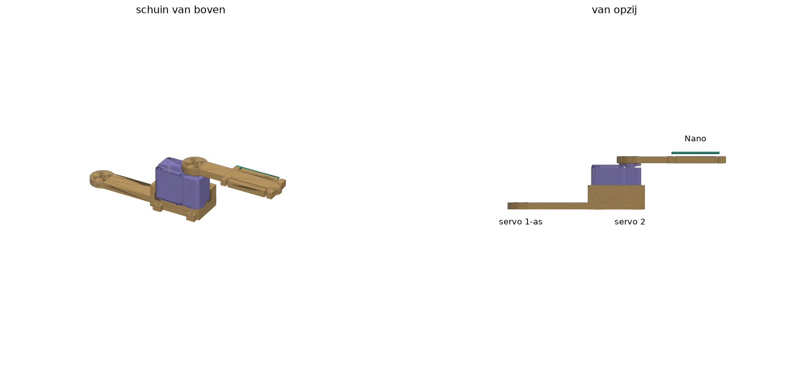

# Two-link pendulum (step 2a)

Servo 1 stays on the table as now. The **upper link** goes on servo 1's horn (4 × M3, the same pattern as the measuring arms). At 100 mm
it has a pocket that holds servo 2's case. The **lower link** goes on servo 2's horn and carries the Nano 33 IoT at 60 mm, with one hole per header pin so it sits without play.

Generated by [`double_pendulum.py`](double_pendulum.py); print file [`../double_pendulum.3mf`](../double_pendulum.3mf) (40% infill, 4 walls,
both parts flat). The fit is checked in the script against official models:

| Check | Source | Result |
|---|---|---|
| Servo 2 in the pocket | official STS3215 STEP ([SO-ARM100](https://github.com/TheRobotStudio/SO-ARM100), `STEP/SO100/STS3215_03a.step`, in `vendor/`) | no overlap (0.000 mm³), 0.25 mm clearance; it rests on the two 0.5 mm pads on its back |
| Servo 2's connectors | same | stick through the window in the plate; the cable leaves underneath |
| Servo 2's axis | same | exactly 100.0 mm from servo 1's axis |
| Lower-link hub against servo 2's horn | same | the 4 horn holes (±4.95 mm) line up with the M3 holes; the centre hole clears the horn screw |
| Nano header pin holes | Arduino datasheet ABX00027, section 6 | one 1.4 mm hole per pin (2 × 15), rows 15.24 mm apart, 2.54 mm pitch, first pin 3.81 mm from the board end. If they print too tight, open them with a 1.2 mm drill |

**Assembly:** servo 2 goes into the pocket with its horn up and its connectors down through the window; two cable ties over the case
through the slots. The Nano's header pins drop into their 30 holes (no play, so the IMU cannot rattle), USB toward servo 2, held with two cable ties. Servo 1 → servo 2 with a
3-pin bus cable (both servos need different IDs). Leave slack in both cables for ±90°.

**Weigh the printed parts** and the complete lower link with the Nano. The simulation needs the real masses (`double_pendulum_params.json`).
