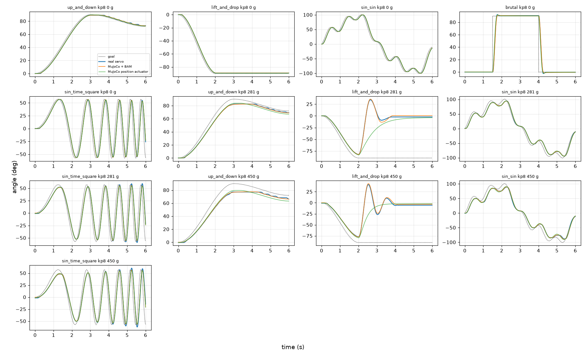

# First MuJoCo test: the fitted models in a real MuJoCo simulation

`scripts/bam_feetech/mujoco_replay.py` builds a one-joint pendulum in MuJoCo 3.7: a hinge with a point mass at the logged length, q = 0 straight down,
1 ms timestep, implicitfast integrator. It then replays **real logged runs**, using their exact goal and torque-enable sequence, with two actuator variants:

1. **MuJoCo + BAM in the loop.** A `<motor>` actuator driven every step by `bam.mujoco.MujocoController`. This is the recommended setup, and the same
   way mjlab's `BamActuatorCfg` works on GPU. When torque is released the motor torque is set to 0 and BAM's friction stays applied.
2. **MuJoCo position actuator.** A standard `<position>` actuator with constant kp, damping, frictionloss, armature and forcerange taken from `bam.to_mujoco`
   for the same fitted model. This is the classic "fitted PD" approach that Open Duck Mini used; it is deprecated in BAM. When torque is released
   kp is set to 0.

Values are the mean |sim − real| angle in degrees.

| Test | MuJoCo + BAM | MuJoCo position actuator |
|---|---:|---:|
| C046 m4, held-out kp 8 runs | **0.65** | 2.32 |
| C046, without `lift_and_drop` | **0.54** | 1.11 |
| C044 m6, held-out kp 8 runs (unit 1) | **1.78** | 3.70 |
| C044, without `lift_and_drop` | **0.61** | 0.96 |
| C044 m6 on **unit 2 (never seen)**, all 52 runs | **1.36** | 3.12 |
| C044 on unit 2, without `lift_and_drop` | **0.62** | 0.91 |

Tables: [c046_m4_val_kp8.md](c046_m4_val_kp8.md), [c044_m6_val_kp8.md](c044_m6_val_kp8.md), [c044_m6_on_id1.md](c044_m6_on_id1.md).
Plots: [c046_m4_val_kp8.png](c046_m4_val_kp8.png), [c044_m6_val_kp8.png](c044_m6_val_kp8.png).

- **Running the BAM model inside MuJoCo gives the same accuracy as BAM's own simulator**: 0.65° against 0.57° for the C046 and 0.62° against 0.65° for
  C044 unit 2. The models carry over to MuJoCo unchanged.
- **The constant position actuator is 1.5–3.6× worse.** It fails most clearly after torque release (`lift_and_drop`). The real arm falls and swings
  through to about +35–45° and back; the position actuator keeps the motor's back-EMF damping when unpowered, so it creeps down without swinging
  (8–10° error). With load it also sags too much in slow moves, because it lacks the load-dependent friction that helps hold the arm.
- The remaining C044 `lift_and_drop` errors are the stick-slip cases (the arm sticking part-way up after release), which no model reproduces exactly.

## Not done yet

- Domain randomization (`friction_scale_range`, `vin_range`, delay) in mjlab.
- A multi-joint robot model.
