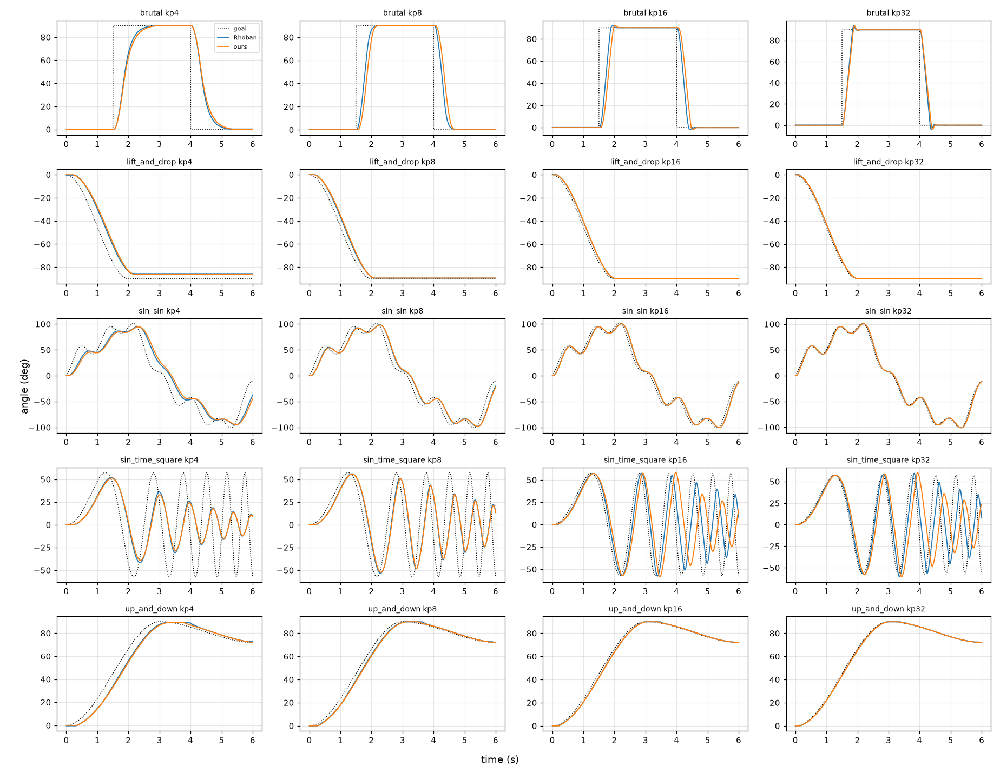

# STS3215-C001 (7.4 V, 1:345): no-load replay of Rhoban's BAM data

**Summary.** The C001 from an SO-101 leader arm (joint 2) was driven with the exact
command sequences of Rhoban's public STS3215 no-load recordings. With the servo as we
found it, the response started about 35–50 ms later than Rhoban's. The cause is
the firmware **acceleration profile** (register 85 = 254, probably written by LeRobot), not the
USB hub and not the servo hardware. With the profile disabled (85 = 0, then 41 = 0),
all 20 runs match Rhoban's traces: 0.1–0.9° mean on 15 runs and 0.4–2.1° on the 5 fast ones. Those 5
had to be re-recorded once the profile was stored off in EEPROM (see *Update 2* below). This also suggests that Rhoban's
servo was a C001-type unit recorded without this profile. This is an inference, because Rhoban
does not document the subtype.

No pendulum (loaded) runs and no BAM fit have been done yet for this servo.

## Hardware and settings

| Item | Value |
|---|---|
| Servo | Feetech STS3215-C001, 7.4 V, 1:345, from SO-101 leader arm joint 2 (Seeed kit SKU 114993667) |
| Bus ID / model / firmware | 2 / 777 / 3.10 |
| Mount | Servo body fixed, metal horn only, no arm or load |
| Bus adapter | CH343 USB serial (1a86:55d3), 1 Mbps, through a USB 2.0 hub (Terminus 1a40:0101) on a MacBook |
| Supply | JOY-iT RD6006 set to 7.40 V / 3.0 A. Idle at the RD6006: 7.38–7.39 V, 0.021 A. Idle in the servo's voltage register: 7.1 V |
| Gains during runs | P = Rhoban's kp of the replayed log (4/8/16/32), D = 0, I = 0. The original P = 32, D = 32 were written back after each run |
| Angle limits | Opened to 0..4095 during runs. RAM only, because the EEPROM lock stayed on; factory 828..3208 return after a power cycle |
| Zero | Raw position at the start of each run (`--zero-here`). About raw 1569 for every run |
| Logging | rustypot, one 8-byte read (pos, speed, load, voltage, temperature) per loop, about 1200 Hz (lift_and_drop about 1900 Hz). Rhoban logged at about 330 Hz |
| Reference data | Rhoban `feetech_sts3215_raw.zip` from https://huggingface.co/buckets/Gregwar/bam_data (100 logs, recorded 27-02-2025, vin 7.4). The `replay_of` field in each of our logs names the Rhoban file it replays |

Rhoban's raw set contains 5 load configurations × 4 gains × 5 trajectories. It starts with
the 20 no-load runs (mass 0, length 0), followed by 0.546 kg / 0.10 m, 1.084 kg / 0.10 m,
1.084 kg / 0.15 m and 0.546 kg / 0.15 m.

## Runs

| Folder | What |
|---|---|
| [20261123-153513-noload-profile254](20261123-153513-noload-profile254/) | All 20 no-load replays with the profile as found (85 = 254, 41 = 0) |
| [20261123-154618-noload-profile-off](20261123-154618-noload-profile-off/) | All 20 no-load replays with the profile off (85 = 0, then 41 = 0) |
| [20261123-accel-register-tests](20261123-accel-register-tests/) | `brutal` kp 32 under different register 41/85 settings, plus the first test run |

Logs are BAM raw format, gzip-compressed and otherwise unchanged (`gunzip -k *.gz`). Extra
fields: `servo_id`, `zero_raw`, `replay_of`, `accel_profile_85_41` (only in later runs) and
`bus_timeouts`.

## Finding 1: the extra delay comes from the servo firmware, not from USB

Measured with [scripts/step_latency_probe.py](../../scripts/step_latency_probe.py), profile on (85 = 254):

- Bus round trip on this USB hub setup: read 0.34 ms median (p99 0.43 ms). Write with
  status reply 0.34 ms (p99 0.42 ms).
- After a +90° goal step at P = 32, the servo's *moving* flag is set at **1.5 ms**. The load
  (PWM) register then ramps slowly: −32 at 14 ms, −96 at 28 ms, −184 at 41 ms and −312 at 55 ms. It
  reaches −1000 (saturation) only after about 145 ms. The shaft moves its first tick at about 50 ms.

So the command arrives almost immediately, and the firmware delays the motion: it moves an
internal target towards the goal with limited acceleration, and the P controller follows
that target.

## Finding 2: the register 85 acceleration profile explains it

`brutal` (90° step), kp 32, no load. Time from the goal step until the shaft passed each angle:

| Setting | 0.2° | 1° | 5° | 20° | 45° | 80° |
|---|---:|---:|---:|---:|---:|---:|
| 85 = 254, 41 = 0 (as found) | 53 ms | 69 ms | 105 ms | 174 ms | 263 ms | 386 ms |
| 85 = 254, 41 = 254 | 53 ms | 68 ms | 105 ms | 174 ms | 264 ms | 386 ms |
| **85 = 0, then 41 = 0 (profile off)** | **22 ms** | **32 ms** | **57 ms** | **118 ms** | **206 ms** | **329 ms** |
| Rhoban reference | 21 ms | 33 ms | 57 ms | 115 ms | 196 ms | 308 ms |

Writing only register 41 changes nothing. Register 85 has to be written first, and it takes effect
only after the next write to 41. That matches the behaviour other people have reported (links below).
We read 85 = 254, 86 = 1 on this unit. Others report a factory value of 50 for register 85, and LeRobot
writes 254 to both 41 and 85 on connect, so the "as found" state depends on what touched the servo last.

## Finding 3: with the profile off, most runs match Rhoban's

Mean |ours − Rhoban| position difference (degrees) over each run, with identical commands.
Full tables are in each run's `comparison.txt`.

| Trajectory | kp 4 | kp 8 | kp 16 | kp 32 |
|---|---:|---:|---:|---:|
| up_and_down | 0.52 | 0.36 | 0.16 | 0.12 |
| lift_and_drop | 0.69 | 0.25 | 0.11 | 0.12 |
| sin_sin | 2.81 | 0.91 | 0.66 | 0.45 |
| brutal | 0.92 | 2.33 | 2.34 | 0.70 |
| sin_time_square | 1.37 | 1.50 | **16.65** | **15.64** |

The same with the profile on: up_and_down 0.24–0.53, sin_sin 2.5–2.8, brutal 2.3–2.7,
sin_time_square 8.3–16.6.



### Not explained yet

- `sin_time_square` at kp 16 and 32, and to a lesser extent `brutal` at kp 8/16 and `sin_sin` at kp 4: our servo
  lags more and overshoots slightly at high speed. Best-fit time lag for sin_time_square kp 16: ours 235 ms, Rhoban
  112 ms. Ours at kp 16 is slower than ours at kp 8, which is not monotonic.
- ~~One hypothesis is supply voltage.~~ This was tested and withdrawn; see *Update 2*.
- The servo's voltage register is unreliable during motion. It reported 6.7–17.8 V while the RD6006
  read 7.31–7.39 V. Do not use it as a safety guard.
- Bus timeouts happened twice, both during a hard 90° step at high current. The recorder now retries them.
  Electrical noise or a dip on the adapter is suspected but not shown.

## Update: profile disabled permanently on this unit (2026-11-23)

The profile was written to EEPROM on servo ID 2. Sequence: torque off, lock (55) = 0, then 85 = 0, then 41 = 0, then lock = 1.
After that the RD6006 output was switched off for 3 s and on again.

- Readback after the power cycle: 85 = 0, 41 = 0, 86 = 1, lock = 1, P/D = 32/32. The angle limits were back at the factory
  828..3208, which confirms that the earlier RAM-only writes were not persisted.
- Step test after the power cycle, with nothing written to 85/41 (`scripts/step_latency_probe.py`, +90° at P = 32):

| | load > 0 | first encoder tick | 5° |
|---|---:|---:|---:|
| Before (85 = 254) | 12.0 ms | 49.6 ms | 105.1 ms |
| After the EEPROM write and power cycle | 1.5 ms | 17.0 ms | 59.0 ms |
| Rhoban reference (`brutal` kp 32, 5°) | | | 57 ms |

So register 85 = 0 persists across power cycles and takes effect at power-up without a fresh write to 41 (this unit,
firmware 3.10). **LeRobot writes 254 to 85 and 41 on every connect**, so after using LeRobot with this servo the profile is on again
until power-off. Runtime code should read 85/41 back at startup and refuse to run on a mismatch.

## Update 2: the 5 deviating runs were the profile, not supply voltage

The 5 runs listed under *Not explained yet* were recorded again after the profile had been stored off in EEPROM.
No RAM toggling of 85/41 was done for these runs.

| Run | Profile-off batch (RAM toggle) | 7.7 V supply | 7.4 V, profile off in EEPROM |
|---|---:|---:|---:|
| brutal kp 8 | 2.33 | 0.43 | 0.68 |
| brutal kp 16 | 2.34 | 0.29 | 0.38 |
| sin_sin kp 4 | 2.81 | 0.70 | 0.91 |
| sin_time_square kp 16 | 16.65 | 1.96 | 1.96 |
| sin_time_square kp 32 | 15.64 | 1.34 | 2.07 |

Values are mean |ours − Rhoban| in degrees. At 7.4 V the runs are about as good as at 7.7 V, so
**supply voltage is not the explanation** and the voltage hypothesis above is withdrawn. In the RAM-toggle batch, these 5 runs had almost exactly the
same deviation as the same runs in the profile-*on* batch (16.65 vs 16.56, 2.33 vs 2.32, 2.81 vs 2.80). So the
profile was most likely still active in those runs, even though the recorder had written 85 = 0, then 41 = 0 before each
of them. This is inferred, not proven. **Treat these 5 runs in
[20261123-154618-noload-profile-off](20261123-154618-noload-profile-off/) as invalid** and use
[20261123-160744-rerun-eeprom-profile-off](20261123-160744-rerun-eeprom-profile-off/) instead.

- The servo reports about 0.3 V less than the RD6006 output even at 21 mA idle. That is too much for cable drop, so it is most likely an
  offset in the servo's own voltage measurement.
- The 7.7 V runs are in [20261123-160641-voltage-test-7v7](20261123-160641-voltage-test-7v7/). The RD6006 was set back to 7.40 V afterwards.
- As a result, `record_sts.py` no longer toggles the profile by default. It reads 85/41 back and logs them in
  `accel_profile_85_41`.

## What this means for simulation (sim2real)

The servo's behaviour depends on registers 85/41, so **the simulator has to model the same setting that
the real robot runs with**. A model identified with the profile off will be about 35–50 ms too fast for a servo
running with the profile on, and the reverse. Options:

1. **Profile off on the robot** (85 = 0, then 41 = 0). This gives less delay, and it is what Rhoban's BAM STS3215 model
   and this replay assume. The robot's startup code must write it (after LeRobot or any other tool connects) and
   **read it back and refuse to start if it is wrong**.
2. **Profile on, and model it**: identify with the same 85/41 values the robot uses, and add an
   acceleration-limited internal target to the actuator model. BAM's STS3215 model only has a velocity limit.
   The MuJoCo Menagerie SO-101 proposal uses `slewmax` for this.

Whichever is chosen, store the 85/41 values with every log and with the simulation model, and check them at runtime.

## Reproduce

Scripts are in [scripts/bam_feetech](../../scripts/bam_feetech/). Copy them into `bam/feetech/` of a
[Rhoban/bam](https://github.com/Rhoban/bam) checkout (`uv sync --extra identification`). Then:

```bash
uv run python -m bam.feetech.sts_check --id 2 --rate
uv run python -m bam.feetech.replay_rhoban --rhoban <dir with raw/*.json> --mass 0 --length 0 \
    --id 2 --motor sts3215_c001 --vin 7.1 --logdir data_raw/c001_noload --zero-here
uv run python -m bam.feetech.compare_rhoban --ours data_raw/c001_noload --rhoban <dir>/raw --plot cmp.png
```

`record_sts.py` leaves registers 85/41 as they are stored in the servo and logs them. `--accel-profile R85 R41` sets them temporarily in RAM, but that proved unreliable. Store the setting in EEPROM instead.

## References

- VatoLabs STS3215 acceleration profile: https://github.com/VatoLabs/STS3215_profile
- rustypot PR #129 (register 85 is u8, 86 = acceleration multiplier): https://github.com/pollen-robotics/rustypot/pull/129
- BAM PR #20, STS3215 12 V identification with the profile disabled: https://github.com/Rhoban/bam/pull/20
- MuJoCo Menagerie SO-101 servo delay proposal: https://github.com/google-deepmind/mujoco_menagerie/issues/368
