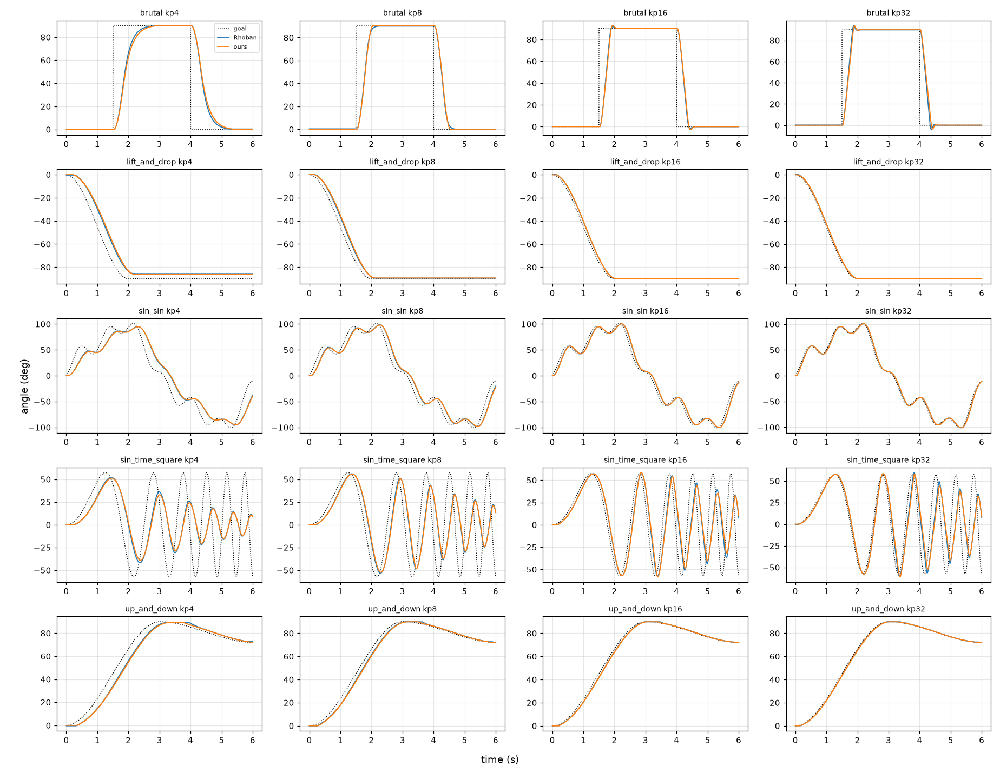

# C001 vs Rhoban: final no-load comparison (20 valid runs)

These are the 15 valid runs of the RAM-toggle profile-off batch plus the 5 re-runs with the profile stored off in EEPROM. All were recorded at 7.40 V with D = 0. Each of our runs received the exact command sequence of the Rhoban log in the last column.

- **Tracking error** is the mean |goal − position| while torque is on.
- **Ours−Rhoban** is the mean |our position − Rhoban position| (degrees). For p95, 95% of the samples are below this value.

| Trajectory | kp | Tracking error ours (°) | Tracking error Rhoban (°) | Δ | Ours−Rhoban mean (°) | p95 (°) | Our log | Rhoban log |
|---|---:|---:|---:|---:|---:|---:|---|---|
| up_and_down | 4 | 4.59 | 4.45 | +0.14 | 0.52 | 1.33 | [2026-11-23_15h46m59_up_and_down_kp4.json.gz](20261123-154618-noload-profile-off/2026-11-23_15h46m59_up_and_down_kp4.json.gz) | 2025-02-27_10h25m44.json |
| up_and_down | 8 | 2.45 | 2.26 | +0.19 | 0.36 | 1.01 | [2026-11-23_15h47m50_up_and_down_kp8.json.gz](20261123-154618-noload-profile-off/2026-11-23_15h47m50_up_and_down_kp8.json.gz) | 2025-02-27_10h26m31.json |
| up_and_down | 16 | 1.23 | 1.18 | +0.06 | 0.16 | 0.42 | [2026-11-23_15h48m41_up_and_down_kp16.json.gz](20261123-154618-noload-profile-off/2026-11-23_15h48m41_up_and_down_kp16.json.gz) | 2025-02-27_10h27m19.json |
| up_and_down | 32 | 0.66 | 0.66 | +0.00 | 0.12 | 0.30 | [2026-11-23_15h49m31_up_and_down_kp32.json.gz](20261123-154618-noload-profile-off/2026-11-23_15h49m31_up_and_down_kp32.json.gz) | 2025-02-27_10h28m06.json |
| lift_and_drop | 4 | 11.96 | 10.73 | +1.23 | 0.69 | 2.00 | [2026-11-23_15h46m29_lift_and_drop_kp4.json.gz](20261123-154618-noload-profile-off/2026-11-23_15h46m29_lift_and_drop_kp4.json.gz) | 2025-02-27_10h25m34.json |
| lift_and_drop | 8 | 6.40 | 5.70 | +0.69 | 0.25 | 1.53 | [2026-11-23_15h47m20_lift_and_drop_kp8.json.gz](20261123-154618-noload-profile-off/2026-11-23_15h47m20_lift_and_drop_kp8.json.gz) | 2025-02-27_10h26m22.json |
| lift_and_drop | 16 | 3.07 | 2.94 | +0.13 | 0.11 | 0.43 | [2026-11-23_15h48m11_lift_and_drop_kp16.json.gz](20261123-154618-noload-profile-off/2026-11-23_15h48m11_lift_and_drop_kp16.json.gz) | 2025-02-27_10h27m09.json |
| lift_and_drop | 32 | 1.57 | 1.55 | +0.02 | 0.12 | 0.26 | [2026-11-23_15h49m01_lift_and_drop_kp32.json.gz](20261123-154618-noload-profile-off/2026-11-23_15h49m01_lift_and_drop_kp32.json.gz) | 2025-02-27_10h27m56.json |
| sin_sin | 4 | 16.16 | 15.51 | +0.65 | 0.91 | 2.04 | [2026-11-23_16h08m42_sin_sin_kp4.json.gz](20261123-160744-rerun-eeprom-profile-off/2026-11-23_16h08m42_sin_sin_kp4.json.gz) | 2025-02-27_10h25m25.json |
| sin_sin | 8 | 10.42 | 9.85 | +0.56 | 0.91 | 2.47 | [2026-11-23_15h47m30_sin_sin_kp8.json.gz](20261123-154618-noload-profile-off/2026-11-23_15h47m30_sin_sin_kp8.json.gz) | 2025-02-27_10h26m12.json |
| sin_sin | 16 | 5.98 | 5.53 | +0.46 | 0.66 | 1.70 | [2026-11-23_15h48m20_sin_sin_kp16.json.gz](20261123-154618-noload-profile-off/2026-11-23_15h48m20_sin_sin_kp16.json.gz) | 2025-02-27_10h26m59.json |
| sin_sin | 32 | 3.15 | 2.94 | +0.21 | 0.45 | 1.18 | [2026-11-23_15h49m11_sin_sin_kp32.json.gz](20261123-154618-noload-profile-off/2026-11-23_15h49m11_sin_sin_kp32.json.gz) | 2025-02-27_10h27m47.json |
| brutal | 4 | 12.97 | 12.20 | +0.77 | 0.92 | 3.73 | [2026-11-23_15h46m18_brutal_kp4.json.gz](20261123-154618-noload-profile-off/2026-11-23_15h46m18_brutal_kp4.json.gz) | 2025-02-27_10h25m16.json |
| brutal | 8 | 8.67 | 8.52 | +0.15 | 0.68 | 2.25 | [2026-11-23_16h07m53_brutal_kp8.json.gz](20261123-160744-rerun-eeprom-profile-off/2026-11-23_16h07m53_brutal_kp8.json.gz) | 2025-02-27_10h26m03.json |
| brutal | 16 | 6.99 | 6.62 | +0.37 | 0.38 | 2.82 | [2026-11-23_16h08m31_brutal_kp16.json.gz](20261123-160744-rerun-eeprom-profile-off/2026-11-23_16h08m31_brutal_kp16.json.gz) | 2025-02-27_10h26m51.json |
| brutal | 32 | 6.26 | 5.99 | +0.27 | 0.70 | 5.21 | [2026-11-23_15h48m50_brutal_kp32.json.gz](20261123-154618-noload-profile-off/2026-11-23_15h48m50_brutal_kp32.json.gz) | 2025-02-27_10h27m38.json |
| sin_time_square | 4 | 30.29 | 30.23 | +0.06 | 1.37 | 3.89 | [2026-11-23_15h46m49_sin_time_square_kp4.json.gz](20261123-154618-noload-profile-off/2026-11-23_15h46m49_sin_time_square_kp4.json.gz) | 2025-02-27_10h25m52.json |
| sin_time_square | 8 | 27.13 | 25.88 | +1.25 | 1.50 | 3.88 | [2026-11-23_15h47m39_sin_time_square_kp8.json.gz](20261123-154618-noload-profile-off/2026-11-23_15h47m39_sin_time_square_kp8.json.gz) | 2025-02-27_10h26m40.json |
| sin_time_square | 16 | 21.15 | 20.15 | +1.00 | 1.96 | 6.08 | [2026-11-23_16h08m03_sin_time_square_kp16.json.gz](20261123-160744-rerun-eeprom-profile-off/2026-11-23_16h08m03_sin_time_square_kp16.json.gz) | 2025-02-27_10h27m27.json |
| sin_time_square | 32 | 18.04 | 17.09 | +0.96 | 2.07 | 6.97 | [2026-11-23_16h07m44_sin_time_square_kp32.json.gz](20261123-160744-rerun-eeprom-profile-off/2026-11-23_16h07m44_sin_time_square_kp32.json.gz) | 2025-02-27_10h28m14.json |

Overall: mean ours−Rhoban 0.74°, median 0.67°. Our tracking error is higher in 20 of 20 runs, by +0.46° on average (about 5%). That is a small systematic difference, possibly from more friction or a weaker motor in this unit. It is not explained yet.

