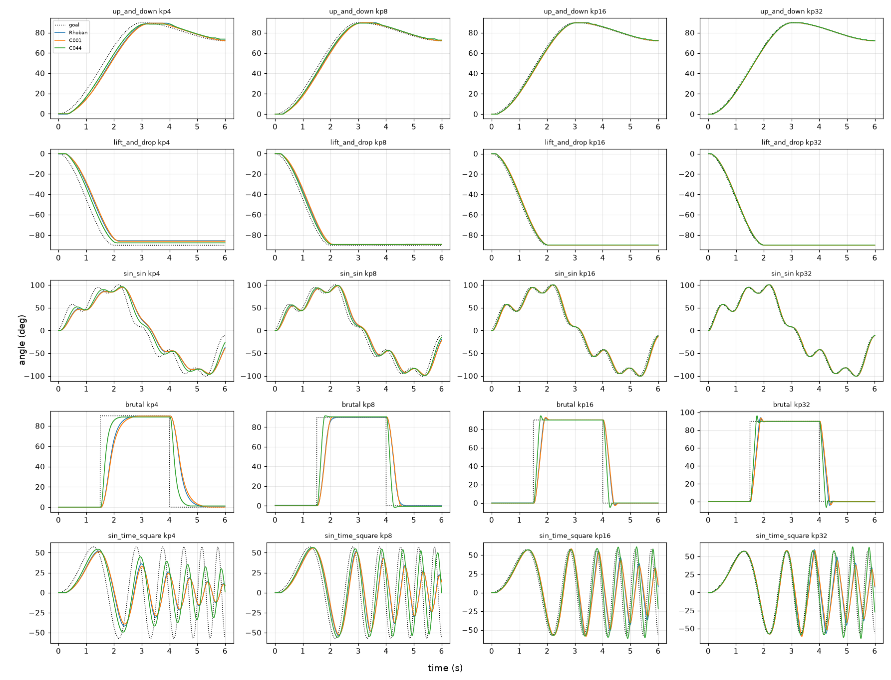

# C044 (7.4 V, 1:191) no-load replay of Rhoban's data, profile off in EEPROM

This is the same procedure as [C001](../../C001/README.md): all 20 no-load Rhoban STS3215 logs, replayed with their exact
command sequences. Unlike the earlier C044 runs in this folder (5 V adapter, D = 32, about 40 Hz, profile on), these runs were made
under the same conditions as the C001 reference set.

## Setup

| Item | Value |
|---|---|
| Servo | STS3215-C044, 7.4 V, 1:191, from SO-101 leader joint 1 or 3, bus ID 3, model 777, firmware 3.10 |
| Mount | Servo body fixed, metal horn only |
| Supply | RD6006 at 7.40 V / 3.0 A |
| Gains | P = Rhoban kp, D = 0, I = 0. P = 32 / D = 32 written back after each run |
| Acceleration profile | Found at 85 = 254, 41 = 0, **86 = 100**. The C001 had 86 = 1. Stored off in EEPROM: lock 0, then 85 = 0, then 41 = 0, then lock 1. After a 3 s supply power cycle the readback was 85 = 0, 41 = 0, 86 = 100 |
| Zero | Shaft moved from raw 3043 to 2048 first (angle limits opened in RAM), then `--zero-here` |
| Logging | rustypot, about 1270 Hz (lift_and_drop about 1940 Hz) |

Step test after the power cycle, +90° at P = 32 (`scripts/step_latency_probe.py 3`): load > 0 at 1.6 ms, first encoder tick at
8.6 ms, 5° at 35.7 ms. The C001 with the profile off took 17.0 ms and 59.0 ms.

## C044 vs C001 vs Rhoban

Full table: [comparison-table.md](comparison-table.md). The C001 column uses the 20 valid C001 runs. The lag is the time shift that
best aligns the measured angle with the goal. Peak speed is computed on a common 5 ms grid.

| Trajectory | kp | Tracking error C044 / C001 / Rhoban (°) | Lag C044 / C001 / Rhoban (ms) |
|---|---:|---|---|
| up_and_down | 32 | 0.56 / 0.66 / 0.66 | 27 / 37 / 35 |
| up_and_down | 4 | 3.57 / 4.59 / 4.45 | 181 / 266 / 246 |
| lift_and_drop | 4 | 7.61 / 11.96 / 10.73 | 171 / 275 / 247 |
| sin_sin | 16 | 3.70 / 5.98 / 5.53 | 44 / 72 / 67 |
| brutal | 32 | 3.93 / 6.26 / 5.99 | 126 / 208 / 195 |
| sin_time_square | 32 | 6.86 / 18.05 / 17.09 | 31 / 105 / 96 |

Peak speed in `brutal` (90° step): C044 about 400–520 °/s, C001 about 210–325 °/s, Rhoban about 225–355 °/s. That is about
1.6× faster, against a gear-ratio ratio of 345/191 = 1.8.

Observations:

- At the same firmware P, the C044 follows the goal with about 35–40% less lag on smooth trajectories, and up to 3× less on
  the fastest part of `sin_time_square`. The firmware P acts on the position error at the output, so a faster motor
  behind the same P gives a stiffer, faster servo without load.
- In `brutal` at kp 16 and 32, the C044 overshoots by about 5°. The C001 and Rhoban overshoot by about 2–3°. This is consistent with
  less reflected rotor inertia and damping, which scale with the gear ratio squared.
- The C044 traces do not match Rhoban's, and they are not expected to: this is a different gear ratio. The C001 data
  shows how close the same type gets (0.74° mean). Using Rhoban's 1:345 model for a C044 would make the simulation
  noticeably slower than the real servo.

Not done yet: pendulum runs and a BAM fit for the C044. Without load, friction, motor constant and inertia cannot be
separated.
