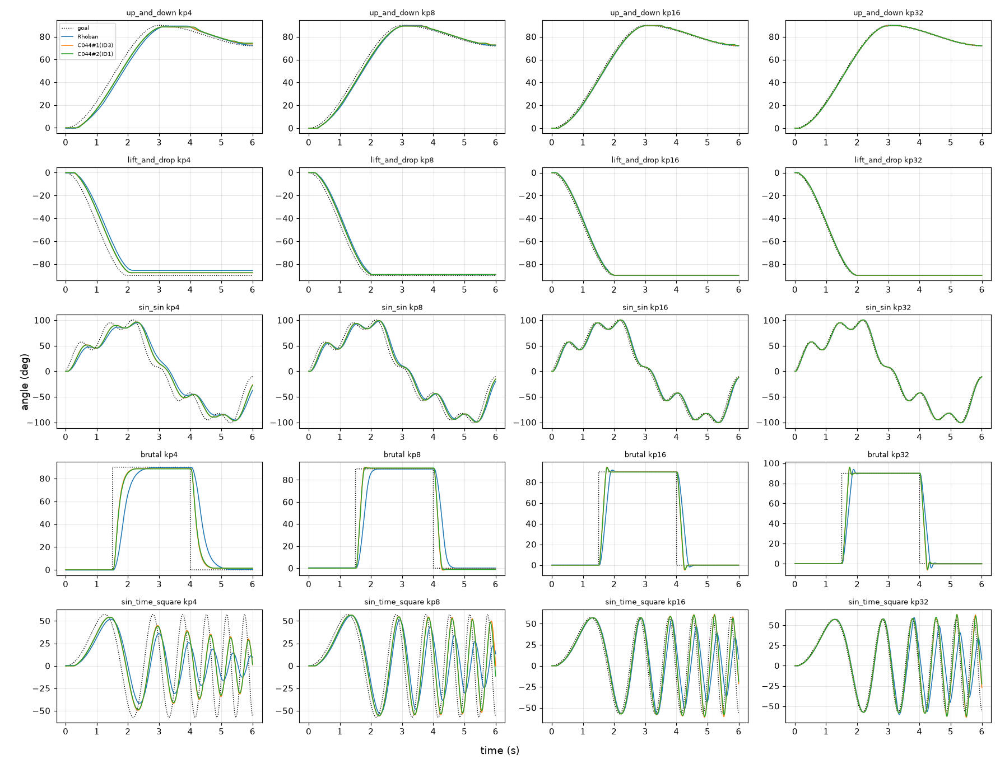

# Second C044 (bus ID 1): no-load replay and unit-to-unit comparison

This is the second STS3215-C044 (7.4 V, 1:191), from SO-101 leader joint 1: bus ID 1, model 777, firmware 3.10. It was measured with the same procedure and settings as
[the first C044 (ID 3)](../20261123-161907-noload-profile-off/README.md):

- Metal horn only, servo body fixed.
- RD6006 at 7.40 V / 3.0 A.
- P = Rhoban kp, D = 0.
- All 20 Rhoban no-load logs replayed with `--zero-here`.

**Acceleration profile.** Found at 85 = 254, 41 = 0, 86 = 100, the same as unit 1. It was stored off in EEPROM (lock 0, 85 = 0, 41 = 0, lock 1) and verified after a 3 s supply power cycle: 85 = 0, 41 = 0, 86 = 100.

**Step test** after the power cycle, +90° at P = 32: load > 0 at 1.6 ms, first encoder tick at 10.2 ms, 5° at **36.4 ms**. Unit 1 took 8.6 ms and 35.7 ms.

## Unit 1 (ID 3) vs unit 2 (ID 1)

Identical commands for both units.

- **|#1 − #2|** is the mean position difference between the two units.
- The last column gives the C001 vs Rhoban difference for scale. That is the same servo type, but two units measured in two different labs.

| Trajectory | kp | Tracking error #1 / #2 (°) | Lag #1 / #2 (ms) | \|#1 − #2\| mean (°) | \|C001 − Rhoban\| (°) |
|---|---:|---|---|---:|---:|
| up_and_down | 4 | 3.57 / 3.74 | 181 / 186 | 0.18 | 0.52 |
| up_and_down | 8 | 1.91 / 1.93 | 93 / 96 | 0.09 | 0.36 |
| up_and_down | 16 | 1.01 / 1.05 | 49 / 50 | 0.09 | 0.16 |
| up_and_down | 32 | 0.56 / 0.58 | 27 / 27 | 0.08 | 0.12 |
| lift_and_drop | 4 | 7.61 / 7.85 | 171 / 175 | 0.11 | 0.69 |
| lift_and_drop | 8 | 3.96 / 4.01 | 87 / 89 | 0.06 | 0.25 |
| lift_and_drop | 16 | 2.03 / 2.08 | 44 / 45 | 0.01 | 0.11 |
| lift_and_drop | 32 | 1.07 / 1.08 | 23 / 23 | 0.08 | 0.12 |
| sin_sin | 4 | 11.83 / 12.16 | 154 / 158 | 0.37 | 0.91 |
| sin_sin | 8 | 7.03 / 7.14 | 85 / 88 | 0.25 | 0.91 |
| sin_sin | 16 | 3.70 / 3.86 | 44 / 46 | 0.14 | 0.66 |
| sin_sin | 32 | 1.94 / 2.02 | 23 / 23 | 0.08 | 0.45 |
| brutal | 4 | 6.91 / 7.36 | 174 / 179 | 0.35 | 0.92 |
| brutal | 8 | 4.80 / 4.99 | 140 / 144 | 0.37 | 0.68 |
| brutal | 16 | 4.08 / 4.09 | 129 / 133 | 0.16 | 0.38 |
| brutal | 32 | 3.93 / 4.17 | 126 / 129 | 0.20 | 0.70 |
| sin_time_square | 4 | 25.19 / 25.18 | 138 / 140 | 0.62 | 1.37 |
| sin_time_square | 8 | 17.93 / 17.99 | 87 / 89 | 0.84 | 1.50 |
| sin_time_square | 16 | 11.17 / 11.79 | 51 / 55 | 0.70 | 1.96 |
| sin_time_square | 32 | 6.86 / 7.27 | 31 / 33 | 0.62 | 2.07 |

**Summary.** Mean |#1 − #2| is **0.27°** (median 0.17°). The tracking error differs by 3.1% on average. Unit 2 is
slightly slower in 19 of 20 runs, by 0–5 ms of lag.

Two C044 units from the same kit are therefore closer to each other (no load) than the C001 is to Rhoban's unit (0.74° mean).
Unit-to-unit spread of this size is small compared with the domain-randomization ranges typically used for RL.

These are only two units, without load and from one kit. The spread under load, and in friction, is not known yet.

