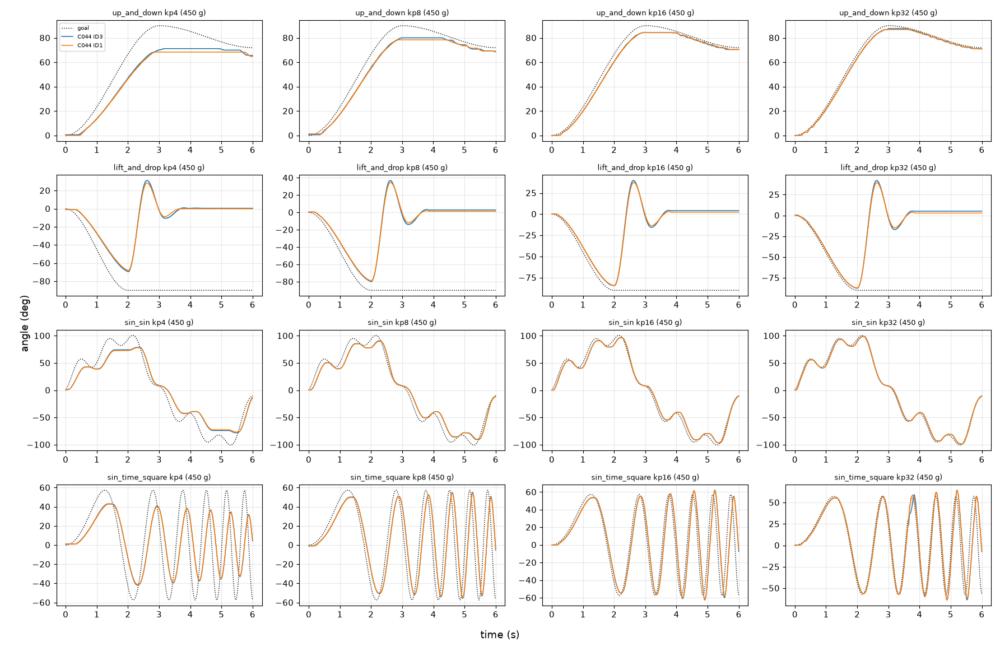

# C044 unit 1 (ID 3) with the 450 g pendulum, and both C044 units compared under load

This is the same pendulum as all the other 450 g sets: 450 g total, centre of mass at 100 mm. Settings: RD6006 at 7.40 V, P = 4/8/16/32, D = 0, profile off in
EEPROM. The zero is the hanging rest position, raw 1982. There were 16 runs with no bus timeouts, and the servo was at 25 °C afterwards. BAM log values: `mass = 0.450`,
`arm_mass = 0`, `length = 0.100`.

## Manual tests (angle limits opened in RAM)

| Test | ID 3 sag / PWM | ID 1 sag / PWM (other C044) |
|---|---|---|
| Hold at +45°, P = 32 | 1.4° / 12% | 1.9° / 16% |
| Hold at +90°, P = 32 | 2.2° / 19% | 3.1° / 27% |
| Hold at −90°, P = 32 | 2.7° / 24% | 3.2° / 29% |
| Hold at +90°, P = 8 | 3.7° / 8% | 4.1° / 9% |
| Release at 44° | Falls without oscillation, stops at 4.4° | Stops at 3.7° |

The ID 3 unit needs about 30% less PWM to hold the same load, which suggests more gearbox friction helping to hold it.

## ID 3 vs ID 1, same load and same trajectories

| Trajectory | kp | Tracking error ID3 / ID1 (°) | Lag ID3 / ID1 (ms) | Max PWM ID3 / ID1 | \|ID3 − ID1\| mean (°) |
|---|---:|---|---|---|---:|
| up_and_down | 4 | 12.13 / 13.48 | 399 / 399 | 24% / 25% | 1.46 |
| up_and_down | 8 | 6.25 / 6.90 | 223 / 231 | 26% / 27% | 0.73 |
| up_and_down | 16 | 3.45 / 3.44 | 116 / 121 | 28% / 29% | 0.23 |
| up_and_down | 32 | 1.69 / 1.80 | 62 / 64 | 30% / 31% | 0.23 |
| lift_and_drop | 4 | 15.36 / 15.70 | 399 / 399 | 27% / 28% | 0.98 |
| lift_and_drop | 8 | 8.65 / 9.06 | 203 / 215 | 29% / 31% | 1.33 |
| lift_and_drop | 16 | 4.80 / 5.04 | 103 / 108 | 31% / 33% | 1.46 |
| lift_and_drop | 32 | 2.66 / 2.64 | 53 / 55 | 32% / 34% | 1.58 |
| sin_sin | 4 | 15.55 / 16.26 | 152 / 157 | 39% / 40% | 0.72 |
| sin_sin | 8 | 8.67 / 8.92 | 86 / 89 | 48% / 49% | 0.37 |
| sin_sin | 16 | 4.72 / 4.84 | 44 / 46 | 50% / 52% | 0.25 |
| sin_sin | 32 | 2.50 / 2.52 | 23 / 23 | 51% / 54% | 0.15 |
| sin_time_square | 4 | 25.82 / 25.73 | 137 / 139 | 73% / 74% | 0.41 |
| sin_time_square | 8 | 19.13 / 19.27 | 90 / 92 | 100% / 100% | 0.46 |
| sin_time_square | 16 | 12.79 / 13.29 | 59 / 60 | 100% / 100% | 0.45 |
| sin_time_square | 32 | 8.70 / 8.97 | 40 / 41 | 100% / 100% | 0.67 |

Mean |ID3 − ID1| with 450 g: 0.72° (median 0.57°). ID1 tracking error relative to ID3: +3.6% on average. Without load the same pair differed by 0.27°.

- **With load the two units differ more than without load:** 0.72° mean against 0.27° without load. The difference sits mainly in
  `lift_and_drop`, where the arm coasts to rest after release (1.0–1.6°), and in slow moves at low P. Both are friction-dominated situations.
- **The tracking error still differs by only about 4%**, and the fast trajectories match within 0.15–0.7°.
- So friction varies more between units than motor strength or speed. Friction is therefore the parameter to randomize most widely in RL.

