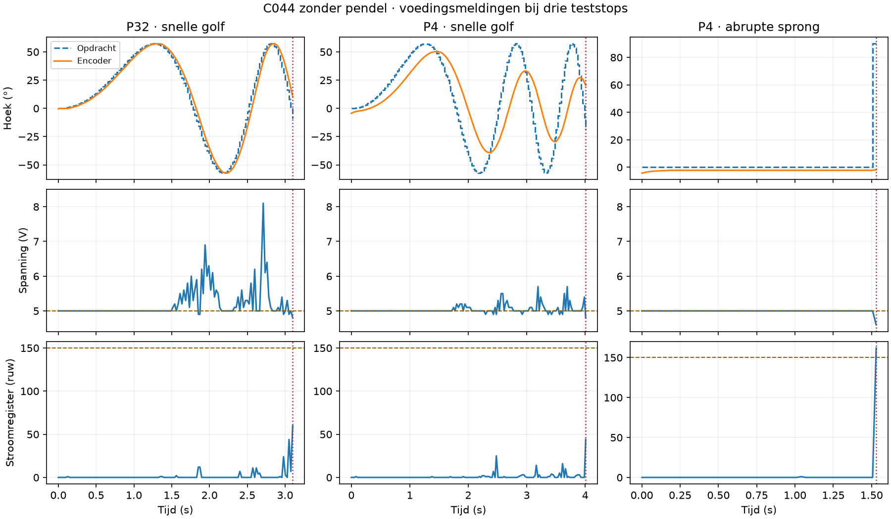

# C044 supply behavior during unloaded motion

The voltage and raw current come from the servo registers. Dotted vertical lines mark the last observation. The dashed horizontal lines show 5.0 V and the recorder's 150-count current threshold. A brief 4.9 V indication can be recorded under the existing debounce rule.

| Pattern | Gain P | Duration (s) | Reported V range | Raw current at stop |
|---|---:|---:|---:|---:|
| Increasing-frequency sine | 32 | 3.101 | 4.8–8.1 | 60 |
| Increasing-frequency sine | 4 | 4.008 | 4.8–5.7 | 44 |
| Abrupt step | 4 | 1.530 | 4.6–5.0 | 162 |

A subsequent read-only idle check returned 5.0 V in all 60 samples. Torque enable read 0, P=32, D=32, I=0, and settings lock=1. This confirms the idle state. It cannot establish rail stability during motion.

The runs show three excursion events during motion with the 5 V setup. The voltage register provides evidence of the stop condition. The electrical cause remains open. Measurements at the servo connector with sufficient time resolution could distinguish real rail excursions from a telemetry issue. A suitable regulated supply with voltage headroom and transient current capacity is another way to retest. Confirm the power board and all connected devices support the selected supply. The [C044 datasheet](https://files.seeedstudio.com/products/Feetech/101090141_Feetech_ST-3215-C044_Datasheet.pdf) gives a 5.0–8.4 V input range.

The remaining eight combinations retain the original BAM command profiles. Slower or smaller commands would be separate experiments.
