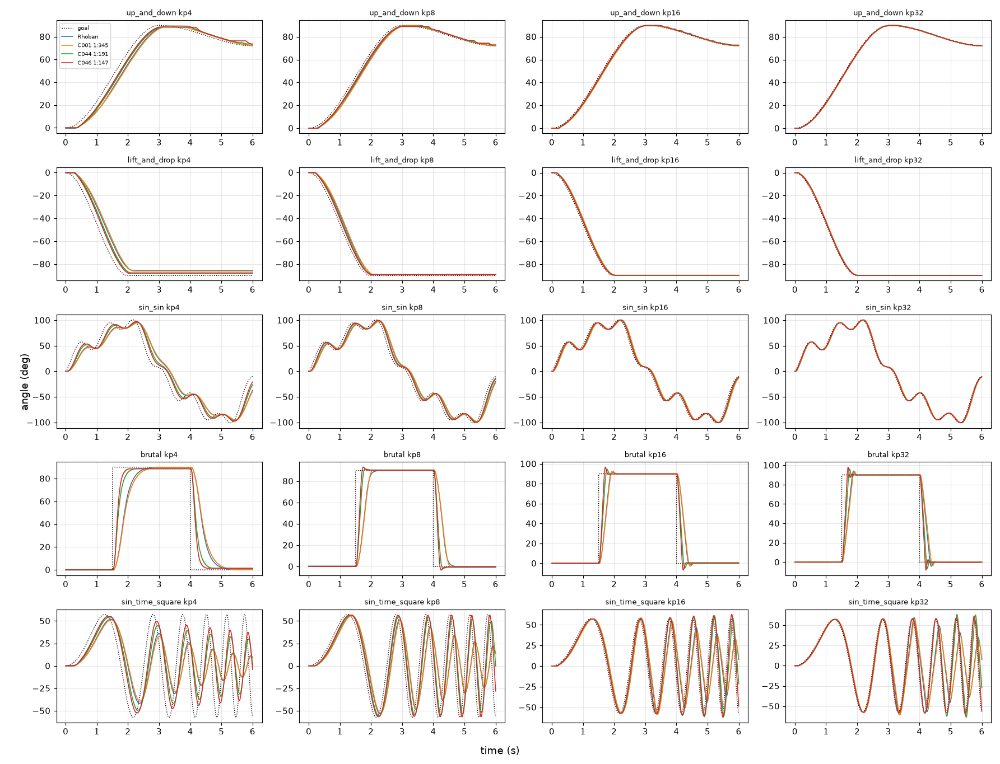

# C046 (7.4 V, 1:147) no-load replay of Rhoban's data, profile off in EEPROM

This uses the same procedure as [C001](../../C001/README.md) and [C044](../../C044/20261123-161907-noload-profile-off/README.md): all 20
no-load Rhoban STS3215 logs, replayed with their exact command sequences.

## Setup

| Item | Value |
|---|---|
| Servo | STS3215-C046, 7.4 V, 1:147, from SO-101 leader joint 4, bus ID 4, model 777, firmware 3.10 |
| Mount | Servo body fixed, metal horn only |
| Supply | RD6006 at 7.40 V / 3.0 A |
| Gains | P = Rhoban kp, D = 0, I = 0. P = 32 / D = 32 were written back after each run |
| Acceleration profile | Found at 85 = 254, 41 = 0, 86 = 100, the same as both C044 units. Stored off in EEPROM (lock 0, 85 = 0, 41 = 0, lock 1). After a 3 s supply power cycle: 85 = 0, 41 = 0, 86 = 100 |
| Zero | Shaft moved from raw 1426 to 2049 first (angle limits opened in RAM), then `--zero-here` |

Step test after the power cycle, +90° at P = 32 (`scripts/step_latency_probe.py 4`): load > 0 at 1.6 ms, first encoder tick at
10.8 ms, 5° at **31.5 ms**. The C044 units took 35.7 and 36.4 ms; the C001 took 59.0 ms.

## C046 vs C044 vs C001 vs Rhoban

Full table: [comparison-table.md](comparison-table.md). Excerpt, kp 32 unless noted:

| | C046 1:147 | C044 1:191 | C001 1:345 | Rhoban |
|---|---:|---:|---:|---:|
| up_and_down tracking error (°) | 0.52 | 0.56 | 0.66 | 0.66 |
| sin_sin lag (ms) | 18 | 23 | 38 | 35 |
| brutal lag (ms) | 105 | 126 | 208 | 195 |
| sin_time_square tracking error (°) | 4.12 | 6.86 | 18.05 | 17.09 |
| lift_and_drop kp 4 tracking error (°) | 6.25 | 7.61 | 11.96 | 10.73 |
| brutal peak speed (°/s) | about 510–665 | about 400–520 | about 210–325 | about 225–355 |
| brutal overshoot kp 4 / 8 / 16 / 32 (°) | −1.5 / 3.2 / 6.7 / 8.0 | −1.2 / 1.6 / 4.6 / 6.2 | −0.3 / 0.4 / 2.7 / 3.6 | −0.3 / −0.1 / 1.7 / 3.9 |

Observations:

- Without load, the order is consistent across every trajectory and gain: the lower the gear ratio, the less lag and tracking
  error, the higher the peak speed, and the more overshoot. The C046 has about 15–20% less lag than the C044 and about
  half the lag of the C001.
- Peak step speed relative to the C001: C046 about 2.1× (gear ratio 345/147 = 2.35×), C044 about 1.6× (345/191 = 1.8×).
  Speed rises with lower gearing, but by less than the ratio itself.
- The overshoot grows with lower gearing and higher P. This is consistent with reflected rotor inertia and damping scaling with the gear
  ratio squared.
- **Without load this only shows the speed side.** The C046 has the least torque of the three, so the order is expected to change under
  load. This has not been measured yet.

