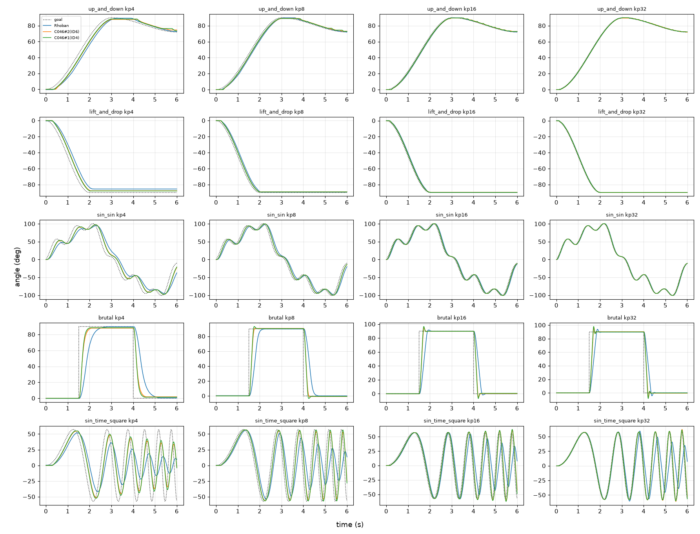

# Second C046 (bus ID 6, gripper): no-load replay and unit-to-unit comparison

This is the second STS3215-C046 (7.4 V, 1:147), the **gripper** servo of the SO-101 leader: bus ID 6, model 777, firmware 3.10. It was measured with the same procedure as [unit 1 (ID 4)](../20261123-163853-noload-profile-off/README.md):

- Metal horn only, servo body fixed.
- RD6006 at 7.40 V / 3.0 A.
- P = Rhoban kp, D = 0.
- All 20 Rhoban no-load logs replayed with `--zero-here`.

**Acceleration profile.** Found at 85 = 254, 41 = 0, 86 = 100. It was stored off in EEPROM (lock 0, 85 = 0, 41 = 0, lock 1) and verified after a 3 s supply power cycle: 85 = 0, 41 = 0, 86 = 100.

**Angle limits.** The factory limits are 2037..3281, the gripper's range. Before the runs the shaft was moved from raw 2326 to 2049 with the limits opened in RAM. After a power cycle the stored limits apply again.

**Step test** after the power cycle, +90° at P = 32: load > 0 at 1.9 ms, first encoder tick at 11.7 ms, 5° at **32.6 ms**. Unit 1 took 10.8 ms and 31.5 ms.

## Unit 1 (ID 4) vs unit 2 (ID 6)

The commands were identical for both units. The last column gives the same difference for the two C044 units, for scale.

| Trajectory | kp | Tracking error #1 / #2 (°) | Lag #1 / #2 (ms) | \|#1 − #2\| mean (°) | C044 units \|#1 − #2\| (°) |
|---|---:|---|---|---:|---:|
| up_and_down | 4 | 3.27 / 3.59 | 150 / 167 | 0.58 | 0.18 |
| up_and_down | 8 | 1.72 / 1.87 | 77 / 86 | 0.29 | 0.09 |
| up_and_down | 16 | 0.93 / 1.02 | 41 / 46 | 0.17 | 0.09 |
| up_and_down | 32 | 0.52 / 0.58 | 23 / 26 | 0.17 | 0.08 |
| lift_and_drop | 4 | 6.25 / 6.73 | 136 / 148 | 0.32 | 0.11 |
| lift_and_drop | 8 | 3.21 / 3.52 | 69 / 76 | 0.08 | 0.06 |
| lift_and_drop | 16 | 1.64 / 1.80 | 35 / 39 | 0.11 | 0.01 |
| lift_and_drop | 32 | 0.87 / 0.96 | 19 / 21 | 0.02 | 0.08 |
| sin_sin | 4 | 9.96 / 10.36 | 125 / 134 | 0.77 | 0.37 |
| sin_sin | 8 | 5.56 / 6.03 | 67 / 72 | 0.47 | 0.25 |
| sin_sin | 16 | 2.95 / 3.18 | 34 / 37 | 0.26 | 0.14 |
| sin_sin | 32 | 1.58 / 1.66 | 18 / 19 | 0.12 | 0.08 |
| brutal | 4 | 5.45 / 6.62 | 148 / 156 | 0.67 | 0.35 |
| brutal | 8 | 3.95 / 4.23 | 119 / 124 | 0.45 | 0.37 |
| brutal | 16 | 3.65 / 3.60 | 108 / 113 | 0.39 | 0.16 |
| brutal | 32 | 3.25 / 3.61 | 105 / 110 | 0.41 | 0.20 |
| sin_time_square | 4 | 22.16 / 22.59 | 116 / 121 | 1.58 | 0.62 |
| sin_time_square | 8 | 14.10 / 15.22 | 68 / 72 | 1.23 | 0.84 |
| sin_time_square | 16 | 7.87 / 8.68 | 35 / 39 | 0.90 | 0.70 |
| sin_time_square | 32 | 4.12 / 4.67 | 19 / 21 | 0.54 | 0.62 |

Mean |#1 − #2| 0.48° (median 0.40°); mean relative tracking-error difference 8.5%; unit 2 has higher tracking error in 19 of 20 runs. For the two C044 units: 0.27° mean.

The two C046 units differ about twice as much as the two C044 units (0.48° vs 0.27° mean). Unit 2, the gripper, is
slower in nearly every run: 2–17 ms more lag and about 8.5% more tracking error. One possible cause is that a leader
gripper servo sees different use and wear from a wrist servo. That was not checked: with only two units it could also be
normal production spread.

This spread is still small next to the difference between servo types. The C046 and C044 differ by 15–20% in lag, and the C001
has about twice the lag of the C046. A domain-randomization range of ±10–20% on friction and motor strength would cover both
units.

