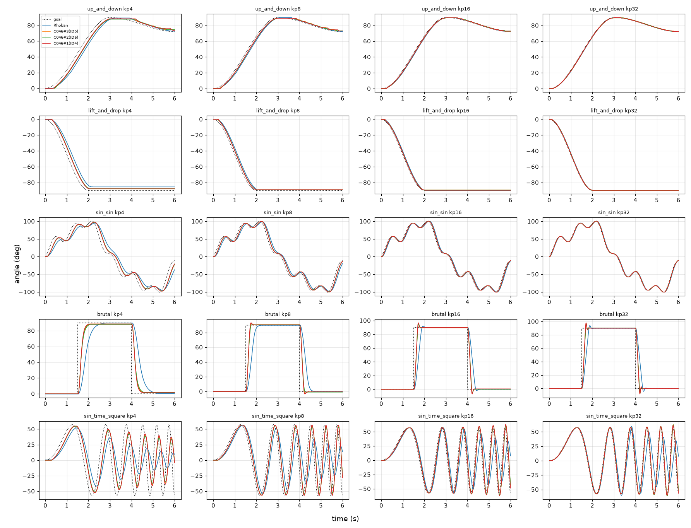

# Third C046 (bus ID 5): no-load replay and comparison of all three C046 units

This is the third STS3215-C046 (7.4 V, 1:147), from SO-101 leader joint 5: bus ID 5, model 777, firmware 3.10. It was measured with the same procedure as
[unit 1 (ID 4)](../20261123-163853-noload-profile-off/README.md) and [unit 2 (ID 6, gripper)](../20261123-164605-unit2-id6-noload-profile-off/README.md):

- Metal horn only, servo body fixed.
- RD6006 at 7.40 V / 3.0 A.
- P = Rhoban kp, D = 0.
- All 20 Rhoban no-load logs replayed with `--zero-here`.

**Acceleration profile.** Found at 85 = 254, 41 = 0, 86 = 100. It was stored off in EEPROM (lock 0, 85 = 0, 41 = 0, lock 1) and verified after a 3 s supply power cycle: 85 = 0, 41 = 0, 86 = 100.

**Angle limits and zero.** Factory angle limits 195..4005. Before the runs the shaft was moved from raw 2062 to 2051 with the limits opened in RAM.

**Step test** after the power cycle, +90° at P = 32: load > 0 at 1.6 ms, first encoder tick at 11.3 ms, 5° at **32.6 ms**. Units 1 and 2 took 31.5 ms and 32.6 ms.

## All three C046 units

The commands were identical for all three units. `|a − b|` is the mean position difference between two units over a run.

| Trajectory | kp | Tracking error #1 / #2 / #3 (°) | Lag #1 / #2 / #3 (ms) | \|#3 − #1\| (°) | \|#3 − #2\| (°) | \|#2 − #1\| (°) |
|---|---:|---|---|---:|---:|---:|
| up_and_down | 4 | 3.27 / 3.59 / 3.23 | 150 / 167 / 153 | 0.32 | 0.39 | 0.58 |
| up_and_down | 8 | 1.72 / 1.87 / 1.76 | 77 / 86 / 79 | 0.23 | 0.24 | 0.29 |
| up_and_down | 16 | 0.93 / 1.02 / 0.93 | 41 / 46 / 42 | 0.12 | 0.16 | 0.17 |
| up_and_down | 32 | 0.52 / 0.58 / 0.52 | 23 / 26 / 23 | 0.15 | 0.13 | 0.17 |
| lift_and_drop | 4 | 6.25 / 6.73 / 6.35 | 136 / 148 / 140 | 0.11 | 0.35 | 0.32 |
| lift_and_drop | 8 | 3.21 / 3.52 / 3.27 | 69 / 76 / 71 | 0.09 | 0.12 | 0.08 |
| lift_and_drop | 16 | 1.64 / 1.80 / 1.69 | 35 / 39 / 36 | 0.15 | 0.10 | 0.11 |
| lift_and_drop | 32 | 0.87 / 0.96 / 0.89 | 19 / 21 / 19 | 0.08 | 0.09 | 0.02 |
| sin_sin | 4 | 9.96 / 10.36 / 10.20 | 125 / 134 / 128 | 0.27 | 0.53 | 0.77 |
| sin_sin | 8 | 5.56 / 6.03 / 5.81 | 67 / 72 / 69 | 0.17 | 0.34 | 0.47 |
| sin_sin | 16 | 2.95 / 3.18 / 3.04 | 34 / 37 / 35 | 0.11 | 0.17 | 0.26 |
| sin_sin | 32 | 1.58 / 1.66 / 1.63 | 18 / 19 / 19 | 0.08 | 0.08 | 0.12 |
| brutal | 4 | 5.45 / 6.62 / 6.29 | 148 / 156 / 152 | 0.26 | 0.49 | 0.67 |
| brutal | 8 | 3.95 / 4.23 / 4.23 | 119 / 124 / 121 | 0.27 | 0.29 | 0.45 |
| brutal | 16 | 3.65 / 3.60 / 3.72 | 108 / 113 / 111 | 0.33 | 0.31 | 0.39 |
| brutal | 32 | 3.25 / 3.61 / 3.49 | 105 / 110 / 107 | 0.18 | 0.24 | 0.41 |
| sin_time_square | 4 | 22.16 / 22.59 / 22.53 | 116 / 121 / 119 | 0.73 | 0.86 | 1.58 |
| sin_time_square | 8 | 14.10 / 15.22 / 14.77 | 68 / 72 / 70 | 0.63 | 0.64 | 1.23 |
| sin_time_square | 16 | 7.87 / 8.68 / 8.26 | 35 / 39 / 37 | 0.50 | 0.43 | 0.90 |
| sin_time_square | 32 | 4.12 / 4.67 / 4.49 | 19 / 21 / 20 | 0.33 | 0.26 | 0.54 |

Mean trace difference: #3−#1 0.26°, #3−#2 0.31°, #2−#1 0.48°.
Tracking error relative to #1: #2 +8.8%, #3 +3.8%. #3 higher than #1 in 18/20 runs, higher than #2 in 1/20.

Unit 3 lies between units 1 and 2, and closer to unit 1. Unit 2, the gripper, remains the slowest. Across the three units
the spread in tracking error is about 9%, and the largest mean trace difference between any two units is 0.48°.

So far, then, five units of three types have been measured without load:

| Type | Units | Spread between units (mean trace difference) |
|---|---:|---|
| C044 1:191 | 2 | 0.27°, about 3% tracking error |
| C046 1:147 | 3 | 0.26–0.48°, up to about 9% tracking error |
| C001 1:345 vs Rhoban's unit | 1 + 1 | 0.74°, about 5% tracking error |

The spread between units of one type stays well below the difference between types, so one model per type plus a
±10–20% domain-randomization range covers these units.

