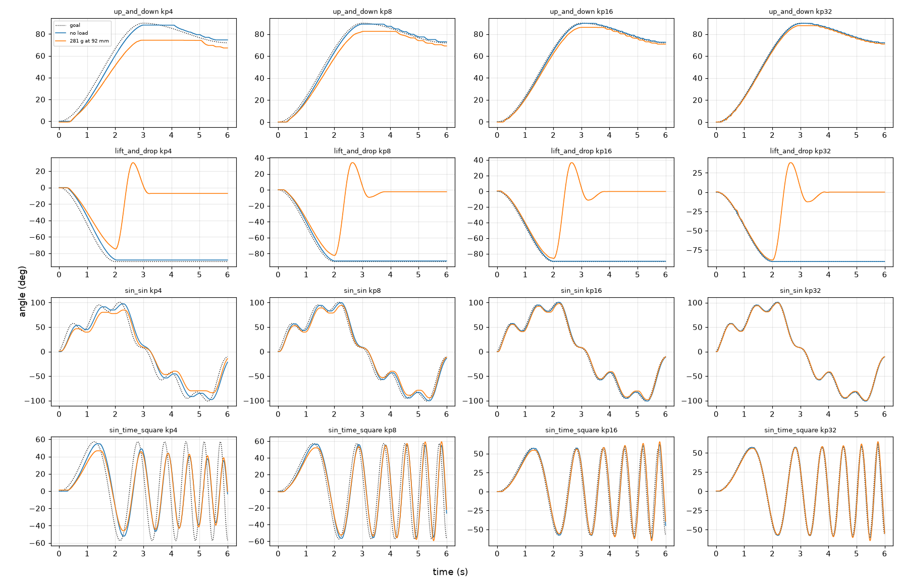

# C046 (ID 5) with pendulum load: 281 g, centre of mass at 92 mm

These are the first loaded runs: the C046 unit 3 (bus ID 5, profile off in EEPROM) driving the short printed arm with two
steel angle brackets bolted to it.

## Load

| Part | Mass | Source |
|---|---:|---|
| 2 steel angle brackets (2 × 133 g) | 266 g | Kitchen scale, 1 g resolution ([photo](../photos/one-bracket-133g.jpg)) |
| 2 × M4 bolt + nut | 5.4 g | [short-arm-mass-estimates.md](../../short-arm-mass-estimates.md) (2.71 g per pair) |
| Short arm BAM-kort-100, bare | 8.8 g | Same file |
| **Total pendulum, weighed as one piece** | **281 g** | Kitchen scale ([photo](../photos/pendulum-total-281g.jpg)); sum of parts 280.2 g |

- **Mounting.** The brackets are bolted through the 75 mm and 100 mm holes ([photo](../photos/pendulum-brackets-mounted.jpg)). One bolt held them too loosely.
- **Centre of mass** of the complete pendulum, without servo or horn: found by balancing it over an edge. The balance point is 18 mm from the
  outer rounded end of the arm. Per `bam_meetarmen.py` that end lies at 110 mm (tip circle of radius 10 mm around the 100 mm hole),
  so the centre of mass is at **92 mm**.
- **BAM log values.** `mass = 0.281`, `arm_mass = 0`, `length = 0.092`: the whole pendulum treated as a point mass at its centre of mass.
  The gravity torque is then exact (0.281 × 9.81 × 0.092 ≈ 0.25 Nm when horizontal). The moment of inertia is **underestimated**,
  because the brackets are about 9 cm wide; the error is estimated at 5–10% and was not measured. A swing-period test would fix this but was not done.

## Settings

| Item | Value |
|---|---|
| Supply | RD6006 at 7.40 V / 3.0 A |
| Zero | Hanging rest position with torque off: raw 2449. 296 samples over 2 s, all equal |
| Gains | P = 4 / 8 / 16 / 32, D = 0, I = 0. The original P = 32 / D = 32 were restored after each run |
| Trajectories | BAM `sin_time_square`, `lift_and_drop`, `up_and_down`, `sin_sin` (BAM's own trajectory functions, not Rhoban replays) |
| Recorder | `all_record_sts.py` → `record_sts.py`, about 1200 Hz (lift_and_drop about 1900 Hz), no bus timeouts. Servo at 28 °C afterwards |

## Manual tests before the runs

From `manual-tests.json.gz`:

| Test | Result |
|---|---|
| Hold at 0, P = 32 | 0.00° error, load 0 |
| Hold at +90° (horizontal), P = 32 | 1.85° sag, load 160/1000 (16% PWM) |
| Hold at −90°, P = 32 | 1.93° sag, load 168/1000. Symmetric with +90°, which confirms the zero |
| Hold at +90°, P = 8 | 2.46° sag, load 54/1000 (5% PWM) |
| Release at 45° (torque off) | No oscillation: reaches 5° after 357 ms, peak speed 158 °/s, stops at 1.3° |

- **BAM's error-gain constant matches this servo.** BAM's STS3215 model gives duty = P × 0.166 × error[rad]. That predicts 17% at P = 32 and
  1.85°, and 5.7% at P = 8 and 2.46°. Measured: 16% and 5.4%.
- **The gearbox carries part of the gravity load.** At P = 8 the motor gives a third of the P = 32 PWM, yet the arm sags only 0.6° more.
  This is load-dependent friction of the kind BAM's m2–m6 models include.
- **Released from 45° the arm does not swing.** Back-EMF braking and friction make it heavily damped. In `lift_and_drop`, which releases
  from −90° at speed, it does overshoot to +30–38° before settling.

## Loaded vs no load (same servo)

| Trajectory | kp | Tracking error no load / 281 g (°) | Lag no load / 281 g (ms) | Max error 281 g (°) | Max PWM 281 g |
|---|---:|---|---|---:|---:|
| up_and_down | 4 | 3.23 / 9.51 | 153 / 322 | 16.3 | 18% |
| up_and_down | 8 | 1.76 / 4.70 | 79 / 169 | 8.8 | 20% |
| up_and_down | 16 | 0.93 / 2.39 | 42 / 88 | 4.7 | 20% |
| up_and_down | 32 | 0.52 / 1.28 | 23 / 46 | 2.5 | 22% |
| lift_and_drop | 4 | 6.35 / 12.41 | 140 / 320 | 18.6 | 21% |
| lift_and_drop | 8 | 3.27 / 6.89 | 71 / 154 | 10.1 | 23% |
| lift_and_drop | 16 | 1.69 / 3.71 | 36 / 78 | 5.3 | 24% |
| lift_and_drop | 32 | 0.89 / 1.99 | 19 / 41 | 4.3 | 38% |
| sin_sin | 4 | 10.20 / 12.53 | 128 / 132 | 29.0 | 33% |
| sin_sin | 8 | 5.81 / 7.07 | 69 / 72 | 16.9 | 38% |
| sin_sin | 16 | 3.04 / 3.72 | 35 / 37 | 8.6 | 38% |
| sin_sin | 32 | 1.63 / 1.97 | 19 / 19 | 4.6 | 40% |
| sin_time_square | 4 | 22.53 / 23.16 | 119 / 119 | 63.5 | 72% |
| sin_time_square | 8 | 14.77 / 15.62 | 70 / 72 | 53.1 | 100% |
| sin_time_square | 16 | 8.26 / 8.99 | 37 / 39 | 36.3 | 100% |
| sin_time_square | 32 | 4.49 / 4.69 | 20 / 20 | 18.6 | 100% |

The no-load columns come from the [no-load replays of the same unit](../20261123-165146-unit3-id5-noload-profile-off/). Those were Rhoban's
logged commands for the same trajectories, so the goals match up to Rhoban's ~3 ms command sampling.

- **Gravity roughly doubles the lag on slow moves** (up_and_down, lift_and_drop). On fast oscillations it barely changes the lag, because those
  are limited by speed and PWM rather than by holding against gravity.
- **At low P the arm hangs well below its goal.** At kp 4 in up_and_down the arm stops about 16° short at the top.
- **The PWM limit is reached** in sin_time_square from kp 8 upwards. This is the regime where the motor model (kt, R, voltage) matters most.

## Not done yet

- A second load configuration: one bracket (about 136 g), and/or the long arm. BAM needs several loads to separate friction, motor constant and inertia.
- The BAM fit itself, the same runs on a C044, and a swing-period test for the inertia.
