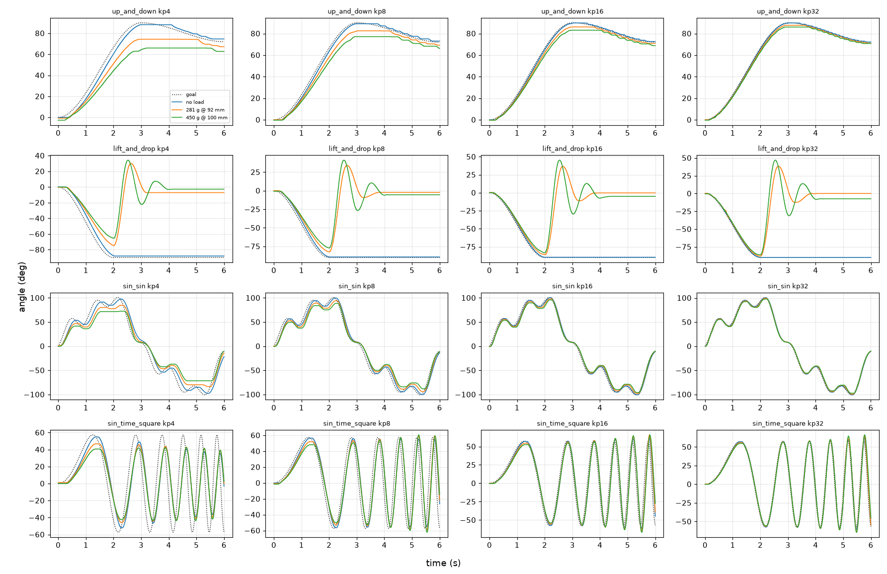

# C046 (ID 5) with pendulum load: 450 g, centre of mass at 100 mm

This is the second load configuration for C046 unit 3 (bus ID 5, profile off in EEPROM): the 281 g pendulum from
[the first loaded set](../20261123-171452-id5-pendulum-281g/README.md) with small steel angle brackets (about 85 g each) added.

## Load

| Item | Value | Source |
|---|---:|---|
| **Total pendulum** (arm, all brackets, bolts and nuts) | **450 g** | Weighed by the operator, kitchen scale with 1 g resolution |
| **Centre of mass** | **100 mm** from the axis | Balance point exactly at the outermost (100 mm) hole of the short arm |
| Gravity torque when horizontal | 0.45 × 9.81 × 0.100 = **0.44 Nm** | Calculated |
| BAM log values | `mass = 0.450`, `arm_mass = 0`, `length = 0.100` | Point mass at the centre of mass. The moment of inertia is underestimated, as for the 281 g set |

The gravity torque is about 1.74× that of the 281 g set (0.25 Nm).

## Settings

- Supply: RD6006 at 7.40 V / 3.0 A.
- P = 4 / 8 / 16 / 32, D = 0.
- Zero: hanging rest position raw **2472**, from 2 s of samples that were all equal.
- Trajectories: BAM `sin_time_square`, `lift_and_drop`, `up_and_down`, `sin_sin`.
- About 1200 Hz (lift_and_drop about 1900 Hz), no bus timeouts.
- The servo read 29 °C afterwards.

## Manual tests

`manual-tests.json.gz` was recorded with this pendulum before it was taken off to be weighed and re-mounted. The zero was then raw 2466.

| Test | Sag | PWM |
|---|---:|---:|
| Hold at +45°, P = 32 | 1.9° | 17% |
| Hold at +90°, P = 32 | 3.4° | 30% |
| Hold at −90°, P = 32 | 3.9° | 34% |
| Hold at +90°, P = 8 | 6.4° | 14% |
| Release at 44° | No oscillation; stops at −3.0° | — |

- Holding PWM at ±90° is about 1.98× that of the 281 g set, while the gravity torque is 1.74×. Either the friction or the PWM-to-torque relation is not
  proportional; the BAM fit has to explain this.
- **The servo temperature register also glitches.** Median 27 °C, but 53 single readings above 45 °C, up to 67 °C. Do not stop on one high reading.
  The first manual-test attempt was aborted by exactly such a glitch.

## 0 g vs 281 g vs 450 g (same servo, same trajectories)

| Trajectory | kp | Tracking error 0 / 281 / 450 g (°) | Lag 0 / 281 / 450 g (ms) | Max error 450 g (°) | Max PWM 281 / 450 g |
|---|---:|---|---|---:|---|
| up_and_down | 4 | 3.23 / 9.51 / 15.52 | 153 / 322 / 399 | 26.7 | 18% / 30% |
| up_and_down | 8 | 1.76 / 4.70 / 8.06 | 79 / 169 / 257 | 14.6 | 20% / 33% |
| up_and_down | 16 | 0.93 / 2.39 / 4.14 | 42 / 88 / 133 | 7.7 | 20% / 34% |
| up_and_down | 32 | 0.52 / 1.28 / 2.23 | 23 / 46 / 69 | 4.1 | 22% / 36% |
| lift_and_drop | 4 | 6.35 / 12.41 / 15.68 | 140 / 320 / 399 | 25.8 | 21% / 29% |
| lift_and_drop | 8 | 3.27 / 6.89 / 9.15 | 71 / 154 / 224 | 14.6 | 23% / 33% |
| lift_and_drop | 16 | 1.69 / 3.71 / 5.09 | 36 / 78 / 112 | 7.9 | 24% / 35% |
| lift_and_drop | 32 | 0.89 / 1.99 / 2.74 | 19 / 41 / 58 | 4.2 | 38% / 38% |
| sin_sin | 4 | 10.20 / 12.53 / 15.97 | 128 / 132 / 128 | 36.4 | 33% / 41% |
| sin_sin | 8 | 5.81 / 7.07 / 8.87 | 69 / 72 / 74 | 22.1 | 38% / 50% |
| sin_sin | 16 | 3.04 / 3.72 / 4.72 | 35 / 37 / 39 | 11.6 | 38% / 52% |
| sin_sin | 32 | 1.63 / 1.97 / 2.47 | 19 / 19 / 20 | 6.4 | 40% / 57% |
| sin_time_square | 4 | 22.53 / 23.16 / 23.80 | 119 / 119 / 119 | 66.1 | 72% / 75% |
| sin_time_square | 8 | 14.77 / 15.62 / 16.77 | 70 / 72 / 75 | 60.4 | 100% / 100% |
| sin_time_square | 16 | 8.26 / 8.99 / 10.07 | 37 / 39 / 42 | 49.7 | 100% / 100% |
| sin_time_square | 32 | 4.49 / 4.69 / 5.38 | 20 / 20 / 22 | 31.0 | 100% / 100% |

- **On slow moves the error grows steadily with load.** At up_and_down kp 16 the lag goes 42 → 88 → 133 ms. Gravity is the dominant effect there.
- **On fast moves the load hardly matters.** At sin_time_square kp 32 the lag goes 20 → 20 → 22 ms. The servo is at its speed and PWM limit there, whatever the load.
- **There is still headroom.** Holding PWM stays below 40% on the slow trajectories, and the servo read 29 °C after all 16 runs.

## Not done yet

- The BAM fit for the C046. It can use these two loaded sets, and optionally the no-load set.
- The same loads on a C044.
- A swing-period test for the inertia.
