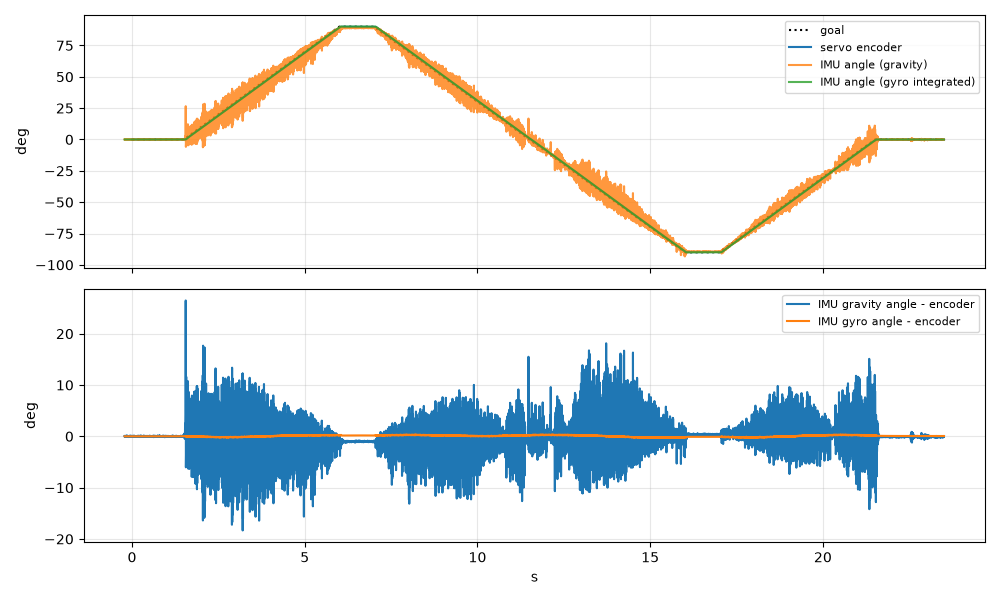

# Nano 33 IoT IMU on the pendulum arm (ID 6, arm only, no hole saws)

The Nano is taped flat on the arm, with its z axis along the servo shaft. The servo swept slowly at 20°/s, P = 32: 0 → +90° → −90° → 0,
holding 1 s at each end. Encoder and IMU were recorded together ([`scripts/imu/servo_imu_sweep.py`](../../../scripts/imu/servo_imu_sweep.py),
analysis in [`scripts/imu/analyse_sweep.py`](../../../scripts/imu/analyse_sweep.py)).

| Quantity | Result |
|---|---|
| Gyro (z), integrated, against the encoder | max difference **0.32°** over the whole 22 s sweep, drift 0.06° (after subtracting the bias measured in the first second) |
| Gravity angle (accelerometer) against the encoder, arm standing still | within about ±1.3° over ±90° (small mounting tilt and accelerometer scale error) |
| Gravity angle **while moving** | up to ±10–25° noise: a **117.5 Hz vibration** from the servo drivetrain at this speed (tangential acceleration ~1.5 m/s² std) |

- **The gyro agrees with the servo encoder to a few tenths of a degree.** The IMU readout, the axes and the time base all work.
- **When a servo moves, the accelerometer sees strong high-frequency vibration**, here 117.5 Hz at 20°/s. The policy runs at 50 Hz, so
  sampling the accelerometer once per step would alias that vibration into large random tilt errors. Average all IMU samples within each
  20 ms step (a 20 ms box filter attenuates 117 Hz to about 12%), and/or combine gyro and accelerometer (a complementary filter) for the
  gravity vector. The gyro itself is hardly affected (1.8°/s std at 117 Hz).
- Next: fast steps to measure the latency between the servo encoder and the IMU.
