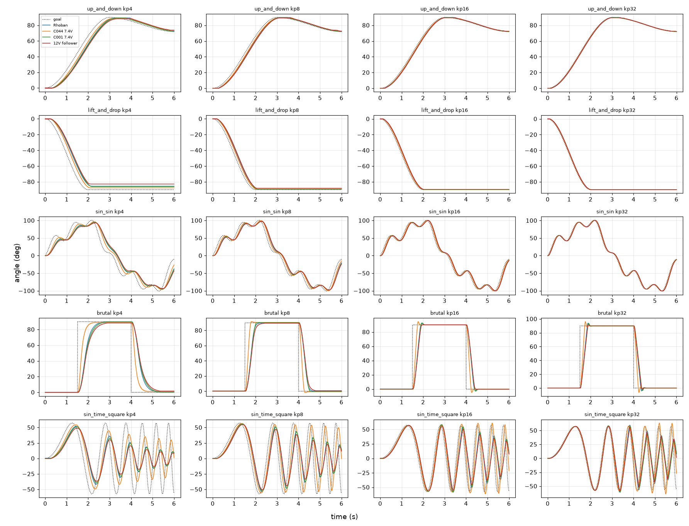

# STS3215 12 V (SO-101 Pro follower, 1:345): no-load replay of Rhoban's data

This uses the same procedure as the leader servos: all 20 no-load Rhoban STS3215 logs, replayed with their exact commands on a follower-arm servo
with only the metal horn attached.

## Setup

| Item | Value |
|---|---|
| Servo | STS3215 12 V version from the SO-101 Pro follower arm (Seeed kit SKU 114993667), 1:345. The exact C-code is not on the servo label we read |
| Bus ID / model / firmware | 3 / 777 / 3.10 |
| Voltage limits in EEPROM | min 4.0 V, **max 14.0 V**. This confirms the 12 V type; the 7.4 V leader servos have a lower limit |
| Supply | The follower kit's 12 V adapter, through the follower controller board (`/dev/cu.usbmodem5B421346401`). The servo reads 12.0 V idle |
| As found | P = 16, D = 32 (LeRobot follower settings), acceleration profile **on** (85 = 254, 41 = 0, 86 = 1), angle limits 849..3063 |
| Profile | Stored off in EEPROM (lock 0, 85 = 0, 41 = 0, lock 1). After unplugging the adapter for about 3 s: 85 = 0, 41 = 0 |
| Gains during runs | P = Rhoban kp, D = 0. P/D were restored afterwards to 32/32; the original P = 16 returns after a power cycle, because the lock stayed on |
| Zero | Shaft moved to raw 2052 first, then `--zero-here` |

**Step test** (+90° at P = 32, profile off): load > 0 at 1.0 ms, first encoder tick at 19.9 ms, 5° at **56.5 ms**. The C001 7.4 V took 59.0 ms.

## Result without load

Full table: [comparison-table.md](comparison-table.md). It compares the 12 V follower, C001 7.4 V, C044 7.4 V and Rhoban's unit.

| | 12 V follower | C001 7.4 V | Rhoban (7.4 V, C001) |
|---|---:|---:|---:|
| up_and_down kp 32, tracking error | 0.78° | 0.66° | 0.66° |
| brutal kp 32, lag | 201 ms | 208 ms | 195 ms |
| brutal, peak step speed | about 200–310 °/s | about 210–310 °/s | about 225–355 °/s |
| sin_time_square kp 32, tracking error | 16.1° | 18.1° | 17.1° |
| kp 4 lag (up_and_down / brutal) | 303 / 388 ms | 266 / 374 ms | 246 / 358 ms |

- **Without load, the 12 V servo behaves almost the same as the 7.4 V C001** (and Rhoban's unit). It is not faster, although it runs at 12 V. This is
  consistent with a motor wound for 12 V: about the same no-load speed at its rated voltage, with more torque. The torque difference should show up under
  load, which is not measured yet.
- At low P (kp 4) it lags somewhat more than the C001 (303 vs 266 ms in up_and_down). That points to somewhat more friction at low drive.
- The 7.4 V C001 model (Rhoban) is therefore a reasonable starting point for this servo without load. A proper 12 V model needs the pendulum runs.

