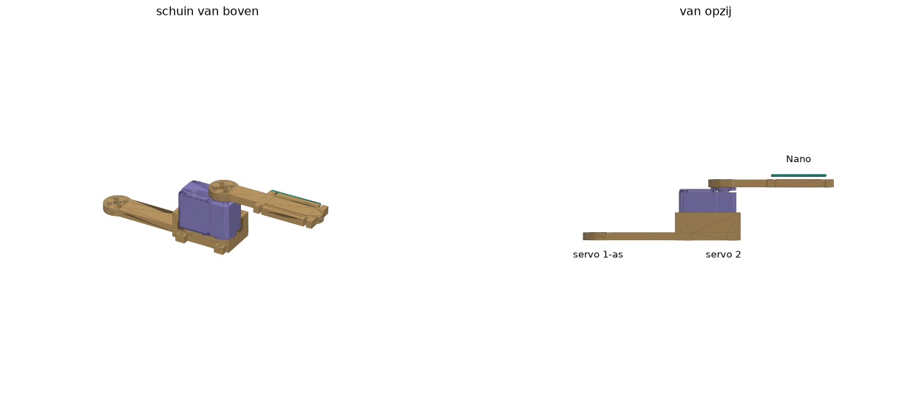
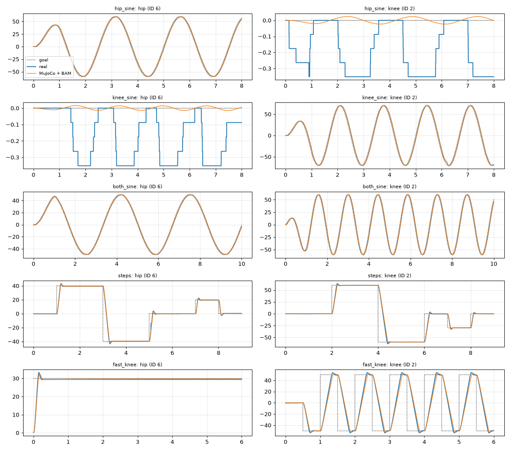
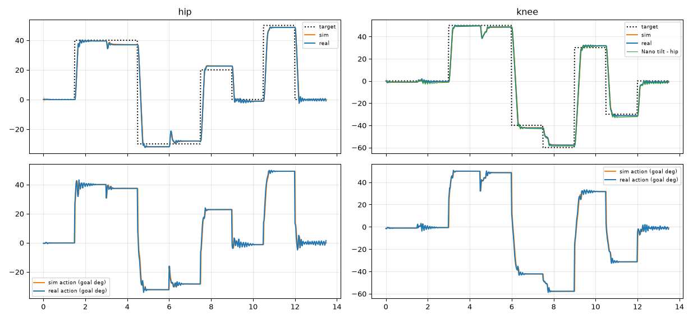

# Two-joint arm, trained in simulation, works on the real servos first time

**Test date:** 2026-11-25 · **Hardware:** two Feetech STS3215-C044 servos (from an SO-101 leader arm) at 5 V, an Arduino Nano 33 IoT as IMU,
3D-printed links · **Software:** MuJoCo + [BAM](https://github.com/Rhoban/bam) servo models, PPO reinforcement learning on a MacBook CPU

<!-- Video links go here: LinkedIn / YouTube / X -->

## What is this about?

Robots that learn to walk are usually trained in a **simulation** first, because a real robot would break long before it has
learned anything. The hard part is the jump back to the real world (**sim2real**): if the simulated motors behave even a little
differently from the real ones, the trained controller wobbles, overshoots or falls over.

Cheap hobby servos like the STS3215 are the weakest link here. Inside they have a motor, a gearbox and their own little controller,
and the simulator does not know any of that. So this project **measures** the servos on a bench and fits a physics model to the
measurements with **BAM** (*Better Actuator Models*, by Rhoban, the team behind the Microduck robot). That model then replaces the
simple motor in MuJoCo.

This test is the proof: **a controller trained only in simulation, run on real hardware without any changes, does exactly what it
did in the simulation.**

## The setup



| Part | What it does |
|---|---|
| **Hip servo** (C044, bus ID 3) | fixed on the table, swings the upper link |
| **Upper link** (printed) | 100 mm long, holds the knee servo in a pocket, screwed like the SO-101 arm parts |
| **Knee servo** (C044, bus ID 1) | swings the lower link |
| **Lower link** (printed) | holds the Nano 33 IoT on its header pins, one hole per pin so it cannot rattle |
| **Nano 33 IoT** | its IMU measures the angle of the lower link in space, filtered on the board itself (Mahony filter, 427 Hz) |
| **MacBook** | runs the controller at 50 Hz: reads both servos and the Nano over USB, sends new goal angles |

The C044 is the 1:191 gearing from the SO-101 **leader** arm. Here it runs at 5 V from the leader arm's adapter. These two servos are
candidates for the knees of a small biped.

Print files: [`double_pendulum.3mf`](../../double_pendulum.3mf), source [`cad/double_pendulum.py`](../../cad/double_pendulum.py)
(checked against the official STS3215 STEP model), details in [cad/README.md](../../cad/README.md).
Nano firmware: [firmware/](../../firmware/README.md).

## Step 1: measure the servos, fit a model (BAM)

Each servo replayed the same command sequences as Rhoban's public STS3215 data, without load and with weights of 281 g and 450 g
on a printed measuring arm. BAM then fits friction, motor constants and gearbox losses to these logs.

- The C044 model predicts runs it never saw to about **0.65°**, also on the second C044 unit
  ([C044 fit](../../fits/C044/README.md)).
- It was fitted at 7.4 V. At 5 V it still predicts a no-load run to **0.30° (ID 1) and 0.34° (ID 3)**
  ([5 V check](../../measurements/C044/)). At 5 V the servo is about 1.4× slower, and the model knows this from the voltage alone.

## Step 2: does the model predict the two-joint arm?

Same goal angles on the real arm and in MuJoCo + BAM. Nothing was tuned to these runs.



| Trajectory | Hip: servo lag | Hip: **sim vs real** | Knee: servo lag | Knee: **sim vs real** |
|---|---:|---:|---:|---:|
| hip sine | 3.21° | **0.17°** | 0.18° | **0.19°** |
| knee sine | 0.17° | **0.17°** | 5.26° | **0.17°** |
| both together | 2.14° | **0.16°** | 5.31° | **0.15°** |
| steps | 2.85° | **0.28°** | 5.29° | **0.61°** |
| fast knee (±50° square wave, 1 Hz) | 0.90° | **0.24°** | 32.09° | **3.26°** |

"Servo lag" is how far the real servo is behind its goal; the simulation lags the same amount. The only bigger miss is the very
fast knee square wave: at full speed the real servo is a little faster than the model at the nominal 5 V. In training the supply voltage is
therefore randomized between 4.8 and 5.4 V.

## Step 3: train a controller in simulation

A neural network (PPO, 1.5 million steps, **11 minutes on the MacBook CPU**) learns to move both joints to target angles. It
sees both servo angles and speeds, the Nano's tilt and gyro, the targets and its own last action.

The lessons from earlier tests are built in from the start ([training checklist](../../docs/training-checklist.md)):

- the servo reports its speed one control step late, in steps of 0.077 rad/s;
- the Nano's tilt drifts about ±1° and its gyro is noisy;
- a strong penalty on jerky actions, so the controller holds still instead of buzzing;
- every training episode randomizes friction (±30%), masses, supply voltage, a small cable spring and 0–10 ms extra delay.

## Step 4: run it on the real arm



Top: joint angles (dotted = target, orange = simulation, blue = real, green = Nano IMU). Bottom: the goal angles the controller sent.
The orange line is almost invisible because the blue line is on top of it.

| | Hip | Knee |
|---|---:|---:|
| Tracking error, real (simulation) | 3.84° (3.82°) | 5.15° (5.23°) |
| **Real vs simulation**, mean | **0.33°** | **0.34°** |
| Real inside the randomized simulation band | 96% | 99% |
| Nano IMU angle vs hip + knee from the encoders | 0.62° mean | |
| Control loop | 50 Hz, 20.00 ms period, 1.7 ms work per tick | |

**It worked the first time, with no changes after training.** The tracking error on the real arm is the same as in simulation, to
within a few hundredths of a degree. The controller holds still at the targets, and the IMU on the moving link agrees with the servo
encoders.

## Why does it match so well?

1. **Measured servos instead of guessed ones.** BAM models the friction and the motor, so the simulated servo is as slow and as
   sticky as the real one.
2. **Weighed parts.** The printed links, the servo, the Nano, the screws and even the USB cable are in the model with their real masses.
3. **The real quirks in simulation.** Late speed readings, IMU drift and voltage are simulated and randomized, so the controller
   cannot learn to rely on details that differ on the real arm.

## The road so far

| Step | Result | Details |
|---|---|---|
| Measure 6 leader servos and 3 12 V followers | hidden acceleration profile found and switched off; each gearing behaves very differently | [README](../../README.md) |
| BAM fits | models predict unseen runs to about 0.6° | [fits](../../fits/README.md), [MuJoCo](../../fits/mujoco/README.md) |
| Nano 33 IoT IMU | 427 Hz, filter on the board, tilt matches the encoder to 0.1–0.3° | [IMU](../../measurements/IMU/20261124-nano-on-arm-id6/README.md) |
| One servo, learned controller | first sim2real test; found the late speed register | [pendulum_policy](../../sim/pendulum_policy/README.md) |
| Two joints, 12 V servos | real vs sim 0.22° | [double_pendulum](../../sim/double_pendulum/README.md) |
| **Two joints, C044 at 5 V** | **real vs sim 0.33°** | this page |
| Next | the same with a 12 V hip and a C044 knee, then a small biped | [biped v3 CAD](../../cad/biped_v3/README.md) |

## Run it yourself

```bash
# model check: same goals on the real arm and in simulation
uv run python sim/double_pendulum/run_traj_real.py --rig c044both
uv run python sim/double_pendulum/compare_traj.py --rig c044both
# train (about 11 min on a laptop CPU) and run
uv run python sim/double_pendulum/train.py --rig c044both --steps 1500000 --envs 6 --out sim/double_pendulum/runs/c044_1
uv run python sim/double_pendulum/run_real.py --rig c044both --onnx sim/double_pendulum/runs/c044_1/policy.onnx --out real.npz
uv run python sim/double_pendulum/run_sim.py --rig c044both --onnx sim/double_pendulum/runs/c044_1/policy.onnx --real real.npz --plot out.png
```

The serial ports are set in [`rig.py`](../../sim/double_pendulum/rig.py). The trained controller is in
[`runs/c044_1/policy.onnx`](../../sim/double_pendulum/runs/c044_1/policy.onnx) and the raw data in
[`data/real_c044_1.npz`](../../sim/double_pendulum/data/real_c044_1.npz).

Credits: [BAM](https://github.com/Rhoban/bam) and the public STS3215 data by Rhoban, [MuJoCo](https://mujoco.org),
[SO-ARM100/101](https://github.com/TheRobotStudio/SO-ARM100) by TheRobotStudio, [stable-baselines3](https://github.com/DLR-RM/stable-baselines3).
