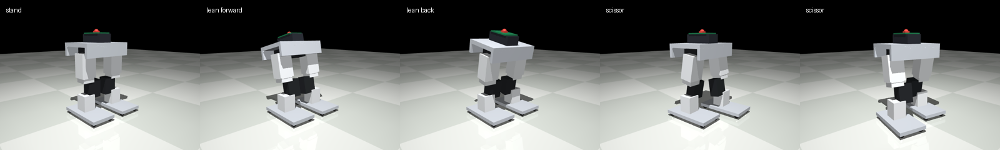
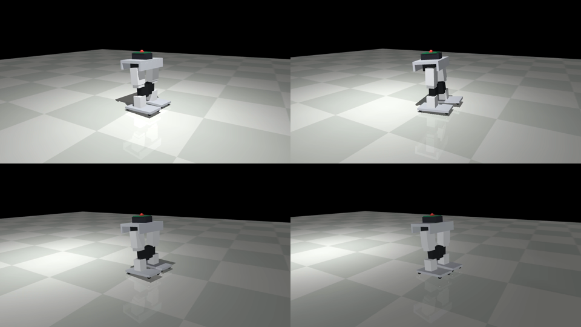
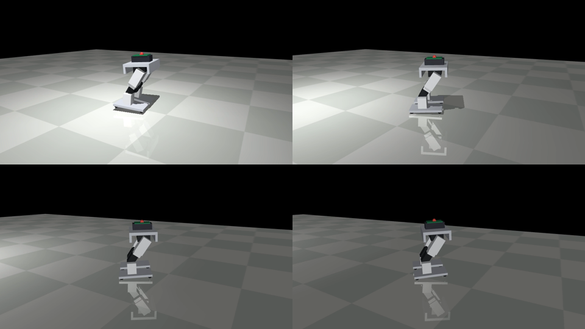
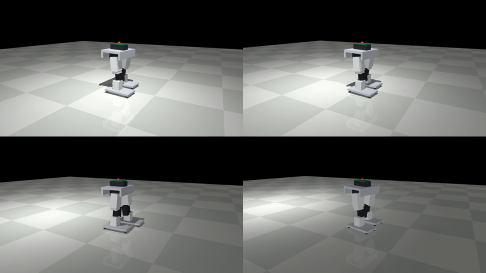

# Simple 4-servo biped in MuJoCo

`biped.xml` is the plain biped from [docs/robot-concepts.html](../../docs/robot-concepts.html), built in MuJoCo with the fitted BAM servo models in
the loop:

- **Hips:** C044, BAM fit [fits/C044/m6.json](../../fits/C044/m6.json).
- **Ankles:** C046, BAM fit [fits/C046/m4.json](../../fits/C046/m4.json).
- All four joints pitch about the lateral axis and are driven by `<motor>` actuators. `run_biped.py` attaches a
  `bam.mujoco.MujocoController` per servo type, which runs the STS3215 firmware P-controller (`kp_fw` = 32, 7.4 V), the motor model and BAM's
  friction every 1 ms step.
- Every part is a box, so weighed masses and measured centres of mass can be entered directly. Foot contact is four rubber pads per foot. The IMU is a
  site in the middle of the pelvis, with quaternion, gyro and accelerometer sensors.
- Total mass **0.569 kg, estimated**: servo 55 g, printed holder 12 g, 2S LiPo 60 g. Replace these with weighed values once it is built.

## First test (2026-11-23)

| Test | What it does | Pelvis height | Max pitch / roll | Max joint error | Result |
|---|---|---|---|---|---|
| stand | all targets 0, 4 s | 0.160 m | 0.2° / 0.0° | 0.1° | upright |
| lean | ankles tilt the body ±0.2 rad | 0.158–0.160 m | 11.7° / 0.0° | 0.7° | upright |
| scissor | hips swing in opposite phase (±0.25 rad), ankles compensate | 0.157–0.160 m | 1.2° / 0.1° | 1.5° | upright |



This only shows that the model is consistent, stands, and that the BAM servos drive it as intended. It is not yet validated against a real robot.

## Hand-made shuffle gait (not a trained policy)

`gait.py` grid-searches a simple open-loop rhythm. The hips swing like scissors (`hip_L = A sin(2πft)`, `hip_R = −hip_L`), and the
ankles follow with amplitude B and phase φ. The search covered 48 combinations (f 1.5/2.5/3.5 Hz, A 0.25/0.4 rad, B 0.1/0.25 rad, four phases);
42 of them fell over. The best ([gait_best.json](gait_best.json)) is **f = 1.5 Hz, A = 0.25 rad, B = 0.25 rad, φ = π**, with the ankles in counter-phase. Over 10 s it shuffles
**76 cm forward** with 0.5 cm sideways drift and at most 8° tilt. Full log: [gait_search.log](gait_search.log).

[biped_walk.mp4](biped_walk.mp4) (10 s, 30 fps, camera follows the pelvis):



This rhythm is only a demonstration that the model can move forward. Without hip roll it slides its feet; a real gait has to come
from RL, and the real robot will slide differently depending on its floor and its foot pads.

## First RL policy (PPO on an M1 MacBook, CPU only)

mjlab needs an NVIDIA GPU, so this run uses plain MuJoCo on the CPU with stable-baselines3 PPO.

**Setup**

- [biped_env.py](biped_env.py): the policy runs at 50 Hz; physics at 2 ms, with the BAM servo models updated every physics step.
- **Action:** 4 joint targets (±0.6 rad).
- **Observation:** joints, gravity in the pelvis frame, gyro, last action, gait clock.
- **Reward:** forward speed up to 0.12 m/s, staying upright, and small penalties for sideways speed, turning, tilt and jerky actions.
- **Randomization per episode:** floor friction ×0.5–1.2, BAM friction ×0.7–1.3, supply 7.0–7.8 V, link masses ±10%, and a 0 or 1 step action delay.

**Training** ([train_ppo.py](train_ppo.py))

- 3 M steps on 6 cores in **27 minutes**.
- The policy learned to stay upright after about 0.5 M steps, and the reward kept rising after that.
- Log: [runs/ppo1/train.log](runs/ppo1/train.log). Model: `runs/ppo1/model.zip` and `vecnorm.pkl`.

**Result** ([eval_policy.py](eval_policy.py), 10 s episodes)

| Test | Forward | Sideways | Falls |
|---|---:|---:|---:|
| Nominal model | 139 cm | 87 cm | 0 |
| 20 randomized episodes with unseen seeds | 167 cm on average (96–259) | 67 cm on average | 0 / 20 |

- **It walks and does not fall, even with randomized friction, voltage and masses.**
- **It drifts sideways and walks a curve.** The penalties on sideways speed and turning are too weak; that is the first thing to fix in a
  second run (reward heading, or penalise lateral drift harder).
- It walks with a wide, asymmetric scissor stance. Whether this transfers to the real robot depends on the floor and the foot pads, which is why
  the floor friction is randomized widely.

[biped_rl_walk.mp4](biped_rl_walk.mp4):



## Second and third RL runs: residual on the gait, all four servos used

The first policy found a shortcut: both hips locked at +34° (the action limit) and the ankles flapped between their limits, buzzing the feet
forward. That is unlikely to transfer, because it depends on the exact foot friction and drives the ankles into their limits.

**v2/v3 environment** (`BipedEnvV2` in [biped_env.py](biped_env.py)):

- **Action:** the policy only adds a correction of at most ±0.15 rad to the hand-made scissor gait (1.5 Hz, hips ±0.25 rad, ankles ±0.25 rad in
  counter-phase). All four servos therefore keep moving.
- **Reward:** forward speed up to 0.12 m/s, plus penalties for heading error, averaged sideways drift (not the per-step wiggle), targets near the
  joint limits, large or jerky corrections, and mechanical power.

**v2 failed** ([runs/ppo2_failed](runs/ppo2_failed/train.log)). With PPO's default action noise, the random corrections at the start made the robot fall
after about 0.5 s. It learned mostly to cancel the gait: corrections near the maximum and only 26 cm forward.

**v3** ([runs/ppo3](runs/ppo3/train.log)) starts with small action noise (`log_std_init = -2`, about ±0.02 rad), so it begins at the working gait and refines
it. 3 M steps on 6 cores took 28 min.

| 10 s walk | Forward | Sideways | Falls | Joint motion (std) |
|---|---:|---:|---:|---|
| Hand-made gait, nominal | 76 cm | 1 cm | 0 | ±14° by design |
| Hand-made gait, 20 randomized | 62 cm mean | 7 cm mean | 0/20 | |
| RL v1 (shortcut), nominal | 139 cm | 87 cm | 0 | hips about 2°, ankles banging into their limits |
| RL v1, 20 randomized | 167 cm mean | 67 cm mean | 0/20 | |
| **RL v3, nominal** | **84 cm** | **8 cm** | **0** | **all four 9–10°** |
| **RL v3, 20 randomized** | **81 cm mean (75–84)** | **11 cm mean** | **0/20** | |

- v3 uses all four servos (each about ±13–17°). Its corrections average 0.21–0.29 of their maximum, and it walks nearly straight (heading −3.7° after 10 s).
- **It is very consistent across the randomized robots: 75–84 cm.** The hand-made gait drops to 62 cm when friction, voltage and masses change. That
  consistency matters more for sim2real than raw distance.

[biped_rl_walk_v3.mp4](biped_rl_walk_v3.mp4):



## Run

From a [Rhoban/bam](https://github.com/Rhoban/bam) checkout with `uv sync --extra mujoco`:

```bash
MUJOCO_GL=cgl uv run python /path/to/sim/biped/run_biped.py --render frames
MUJOCO_GL=cgl uv run python /path/to/sim/biped/gait.py --search
MUJOCO_GL=cgl uv run python /path/to/sim/biped/gait.py --video walk.mp4
uv run python /path/to/sim/biped/train_ppo.py --steps 3000000 --envs 6 --out runs/ppo1
uv run python /path/to/sim/biped/train_ppo.py --env v2 --log-std -2 --steps 3000000 --envs 6 --out runs/ppo3
MUJOCO_GL=cgl uv run python /path/to/sim/biped/eval_policy.py --run runs/ppo1 --video rl.mp4
MUJOCO_GL=cgl uv run python /path/to/sim/biped/eval_policy.py --env v2 --run runs/ppo3 --video rl_v3.mp4
```

RL dependencies: `uv pip install stable-baselines3 gymnasium imageio imageio-ffmpeg`.

To look at the model interactively (without the BAM servos, so the joints are limp):

```bash
uv run python -m mujoco.viewer --mjcf=/path/to/sim/biped/biped.xml
```

On macOS use `mjpython` instead of `python` for the viewer.

## Next steps towards RL

- Build the real biped and weigh each part, then update the masses in `biped.xml`.
- Train in mjlab with `BamActuatorCfg` and the randomization ranges from [docs/sim-setup-guide.md](../../docs/sim-setup-guide.md):
  friction about 0.7–1.3, battery voltage, delay, and backlash once it is measured.
- Store the acceleration profile off (85 = 0, 41 = 0) in all four servos' EEPROM, and check it at startup.
