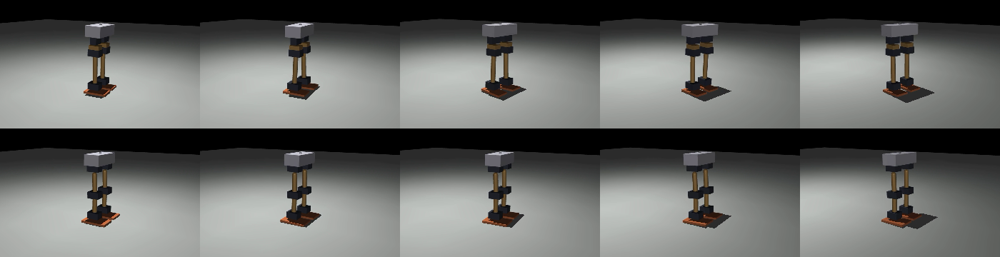

# Choosing the leg layout for a 6-servo biped (rough sketches)

Two rough MuJoCo sketches with six STS3215 12 V servos ([`model.py`](model.py)): servo blocks of the real size and weighed mass (59 g),
SO-101-style brackets, a torso with the Nano; both about 0.5 kg and 0.22 m to the hip. Detailed parts are drawn only for the layout that wins.

- **roll:** per leg hip roll (sideways) → hip pitch → straight leg → ankle pitch.
- **knee:** per leg hip pitch → thigh → knee → shank → ankle pitch (no sideways joint).

Both were trained the same way ([`env.py`](env.py), [`train.py`](train.py)): PPO on the MacBook CPU, 5 M steps each (~50 min, both in
parallel), with everything from the [training checklist](../../docs/training-checklist.md) (BAM 12 V m5 on all joints, 1-step speed lag,
IMU tilt wander and noise, friction / voltage / mass / floor randomization, delay, pushes). Command: walk forward at 0.15 m/s.

| Layout | Nominal: forward / sideways / fell | Randomized ×20: forward mean (min) | Sideways drift | Falls | Mean power |
|---|---|---|---:|---:|---:|
| roll | +51 cm / −10 cm / no | 48 cm (40) | **9 cm** | 0/20 | **2.9 W** |
| knee | +55 cm / +14 cm / no | 48 cm (37) | 21 cm | 0/20 | 5.0 W |

  Videos: [walk_roll.mp4](walk_roll.mp4), [walk_knee.mp4](walk_knee.mp4).

- **Both walk 10 s without falling, also under randomization and pushes, and cover the same distance** (about 5 cm/s, slower than the
  15 cm/s command; both shuffle more than they step after this short training).
- **The roll layout drifts sideways half as much and uses about 40% less power.** With a sideways hip joint it can shift its weight over
  the standing foot; the knee layout has no sideways joint and holds its knees bent under load all the time.
- **Choice: the roll layout** (hip roll, hip pitch, ankle pitch per leg). These are rough sketches with a short CPU training; the gait
  itself (stepping instead of shuffling, speed) is a job for the longer training on the RTX 3090 and the reward recipe from Microduck.
