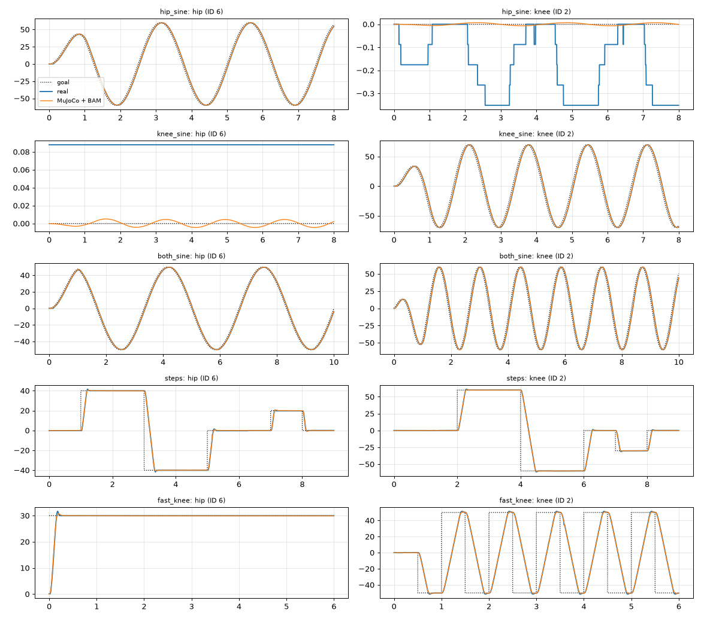
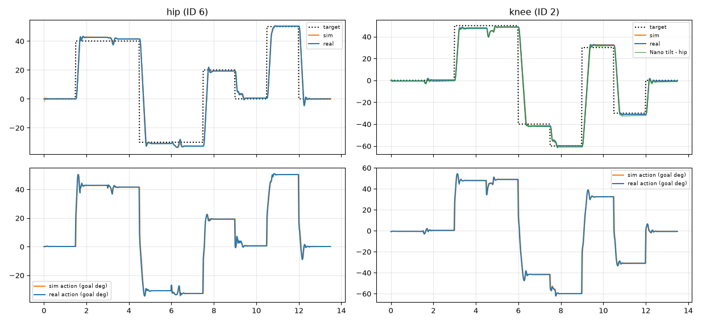

# Two-link pendulum (step 2a): model check

Hip = servo 1 (ID 6) on the table, knee = servo 2 (ID 2) in the pocket of the upper link, Nano 33 IoT on the lower link (hardware:
[cad/](../../cad/README.md)). Both 12 V, profile off, P = 32, D = 0.

## Manual check ([`manual_check.py`](manual_check.py))

Slow 20–30° moves of each joint and both together, while reading both servos and the Nano:

- The Nano's filtered tilt equals hip + knee: **0.07° mean, 0.24° max difference**. On this lower link the board is mounted so its angle
  starts near ±180° (wrap the angle) and its gyro z has the **opposite sign** to the joints.
- Load to hold 30° out: about 3% (hip) and 2.4–4% (knee).

## Model check: same goals on the real arm and in MuJoCo + BAM ([`trajectories.py`](trajectories.py), [`run_traj_real.py`](run_traj_real.py), [`compare_traj.py`](compare_traj.py))

The model ([`dp_model.py`](dp_model.py)): BAM 12 V **m5** on both joints, masses as weighed (servo 59 g, lower assembly 26 g; upper link
estimated 17 g). No fitting to these runs.

| Trajectory | Hip: real tracking error | Hip: **sim vs real** | Knee: real tracking error | Knee: **sim vs real** |
|---|---:|---:|---:|---:|
| hip sine ±60° | 3.77° | **0.27°** | 0.16° | **0.17°** |
| knee sine ±70° | 0.09° | **0.09°** | 6.39° | **0.52°** |
| both sine | 2.43° | **0.18°** | 6.44° | **0.39°** |
| steps | 3.07° | **0.20°** | 6.63° | **0.18°** |
| fast knee (±50° square, 1 Hz) | 0.53° | **0.06°** | 37.65° | **0.37°** |

- **The simulation predicts both joints to 0.06–0.52°**, also with both moving at once and the knee pushing back on the hip. The 12 V m5
  model fitted on the single pendulum carries over to a two-joint chain without changes.
- The large "real tracking error" values are the servos lagging behind fast goals (the knee cannot follow a 1 Hz ±50° square wave);
  the simulation has the same lag.
- When only the hip moves, the real knee is pushed up to 0.35° (4 encoder steps) by the motion; the simulation shows less (0.01°).

## Policy on both joints: trained in simulation, run on the real arm ([`dp_env.py`](dp_env.py), [`train.py`](train.py), [`run_real.py`](run_real.py), [`run_sim.py`](run_sim.py))

PPO, 1.5 M steps on the MacBook CPU (6.6 min), with everything from the one-servo test in from the start (speed-register lag and
quantisation, Nano tilt wander, smoothness penalty 3.0) plus randomized masses and a small cable spring/friction per joint.
Observation: both encoders, both servo speeds, Nano tilt and gyro, both targets and errors, last action. Goals clamped to ±80°.
Masses: upper link 22 g and as-built lower link 12.3 g from the Bambu Studio slice (35.6 g for both, split by volume); this changed
the model check above by less than 0.01°.

| | Hip | Knee |
|---|---:|---:|
| Tracking error, real (sim) | 4.08° (3.99°) | 5.59° (5.47°) |
| **Real vs sim**, mean / max | **0.22° / 1.96°** | **0.23° / 2.47°** |
| Real inside the randomized sim band | 100% | 100% |
| Oscillation while holding (action std), real | 0.01° | 0.01° |

- **It worked the first time on the real arm**, with no changes after the simulation: same response as in simulation, no oscillation.
  The lessons from the one-servo test (speed lag, smoothness) were already in the training.
- Loop on the Mac with two servos and the Nano: 20.00 ms period (max 20.00), 1.8 ms work per tick (max 4.4), fresh IMU data every tick.
- Nano tilt against hip + knee during the run: 0.69° mean (includes fast moves).

**Second real run** (same policy): real vs sim 0.20° / 0.27° mean (hip / knee), 100% inside the randomized band, no oscillation.
Run 1 vs run 2 differ by only 0.09° / 0.10° mean, so the real arm is very repeatable.
