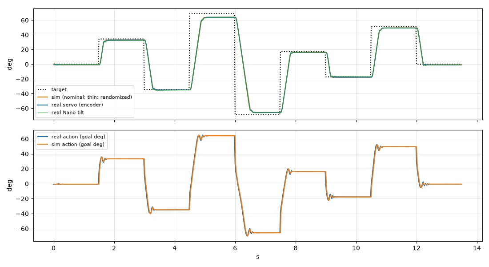

# Sim2real pipeline test on one servo

The whole chain the robot will use, on a single joint: the pendulum arm (ID 6, 12 V, arm only) with the Arduino Nano 33 IoT IMU taped on it.

1. **Simulation** ([`pend_env.py`](pend_env.py)): MuJoCo pendulum with the BAM 12 V **m5** actuator in the loop (kp_fw 32), Nano mass at 8.2 cm
   (estimated from the centripetal acceleration in the step test). Domain randomization and sensor models as in the
   [training checklist](../../docs/training-checklist.md).
2. **Training** ([`train.py`](train.py)): PPO (stable-baselines3, CPU, 6 envs). The task: move the arm to random target angles (±69°).
   Observation: encoder angle, servo speed, Nano tilt, Nano gyro, target, error, last action. Action: goal position.
3. **Export** to ONNX with the observation normaliser inside.
4. **Robot loop on the Mac** ([`run_real.py`](run_real.py)): every 20 ms it reads the Nano (USB) and the servo (USB adapter), runs the ONNX
   policy and writes the goal.
5. **Comparison** ([`run_sim.py`](run_sim.py)): the same fixed target schedule in simulation (nominal + 10 randomized) and on the real servo.

## Result



| Run | Real tracking error | Real vs sim (mean / max) | Real inside the randomized sim band | Oscillation while holding (action std) |
|---|---:|---|---:|---:|
| p2: no speed lag in sim | 10.85° | 2.75° / 9.6° | 64% | **9.8°** at 8.5 Hz (sim: none) |
| **p4: speed lag + quantisation in sim** | **10.08°** | **0.24° / 1.4°** | **100%** | **0.1°** (sim: 0.1°) |

The tracking error is mostly the time the arm needs after each target jump. Both sim and real stop 2–4° short of the larger targets; this
comes from the smoothness penalty and is the same in both.

**Control loop on the Mac:** period 20.00 ms (max 20.29), 0.9–1.0 ms work per tick, Nano IMU data 0.9 ms old (max 3.4), never a tick
without fresh IMU data.

## What went wrong first, and the fix

- **p1 chattered** (the goal jumped back and forth every step, also in simulation): the penalty on action changes was too weak (0.05).
  At 1.0 (p2) it became smooth in simulation.
- **p2 oscillated at 8.5 Hz on the real servo, not in simulation.** The cause: the servo's **speed register is one control step (20 ms)
  late** (firmware averaging) and quantised to **0.0767 rad/s**. The Nano gyro is not late. Microduck models the same one-step lag on
  joint velocity. Adding the lag and the quantisation to the simulation reproduced the oscillation in simulation (p2: 5.8° mean, up to
  11°, against 9.8° real).
- **p3** (retrained with the lag) still oscillated in simulation. **p4** (smoothness penalty 3.0, 800k steps) holds still in simulation, and
  then also on the real servo.

**Lesson for the robot:** first check that the simulation shows the same failure as the real robot, then fix the policy in simulation.
The one-step speed lag and the quantisation must be in the robot's training (they are now on the checklist).

## Reproduce

```
uv run --project ~/projects/bam python sim/pendulum_policy/train.py --steps 800000 --out sim/pendulum_policy/runs/p4
uv run --project ~/projects/bam python sim/pendulum_policy/run_real.py --onnx sim/pendulum_policy/runs/p4/policy.onnx --out real.npz
uv run --project ~/projects/bam python sim/pendulum_policy/run_sim.py --onnx sim/pendulum_policy/runs/p4/policy.onnx --real real.npz --plot out.png
```
Needs `onnx` and `onnxruntime` in the BAM environment, installed with `protobuf>=3.20,<4` so that wandb (`bam.fit`) keeps working.
